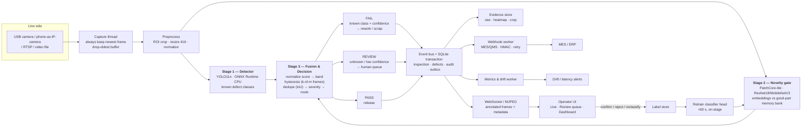

# Real-Time AI Quality Assurance & Defect Detection
## Master Execution Plan — Hackathon Edition

> **Superseded as of 2026-10-29.** Current metrics, operating point, gate status, and evaluation protocol live in `README.md` and `OPTIMIZATION_CONTEXT.md`. This file is retained as historical planning context; do not quote its targets or hardware assumptions as current results.

> **Status:** Final plan. No code written.
> **Environment verified:** Python 3.x, OpenCV 4.11, ONNX Runtime 1.20.1, Node 24, Docker present.
> **GPU UPDATE:** RTX 4060 Laptop **8 GB** + 32 GB RAM confirmed available. This upgrades the plan: YOLO11**s** @640 (was n), TensorRT FP16 demo path, real training budget. See `TRAINING_SPEC.md` for the frozen model spec.
> **Consequence:** Train and demo on GPU; keep **ONNX INT8 CPU as the deployment/fallback path** so "edge-ready" is true and the demo survives a GPU driver failure.

---

# 1. The One-Page Decision

**Build:** a single-camera **surface inspection cell** that streams video, detects and classifies defects live, and returns a **three-tier verdict — PASS / REVIEW / FAIL** — with a defect class, severity, and a routing destination. Unknown defect types are escalated to a human instead of being force-classified.

**The one thing that wins the room:** deliberately **withhold one defect class from training**. At the demo, feed that class in and show:

> "It has never seen this defect. It could have passed silently. Instead the novelty gate scores it 3.4× over threshold, labels it UNKNOWN, and routes it to a human — and that confirmation becomes tomorrow's training data."

That single 30-second moment answers the two questions that kill every other team:
- *"What happens when a new defect type appears?"*
- *"How is this different from a CNN classifier?"*

**Stack in one line:** YOLO11n (supervised, known defects) + PatchCore-lite (unsupervised, novelty gate) + fusion policy + review queue + audit trail, all on ONNX Runtime CPU behind FastAPI.

**Hard rules:**
1. **H8 walking skeleton** — real camera → boxes on screen. A fake model is acceptable at H8. Nothing else matters until this works.
2. **CPU-first.** No CUDA assumptions anywhere in the critical path.
3. **Server owns the camera.** Browser receives MJPEG + JSON. No `getUserMedia`, no permission dialogs on stage.
4. **H40 demo freeze.** Only P0 fixes after that.
5. **Every number on screen is measured**, and labeled with the hardware it was measured on.

---

# 2. Positioning: Why This Angle

Three viable angles exist. Only one scores well on all five judging criteria.

| Angle | What it is | Strength | Fatal weakness | Verdict |
|---|---|---|---|---|
| **A. Pure unsupervised anomaly detection** | PatchCore on good parts → heatmap | Zero labels, new part in 5 min, great "unknown defect" story | Cannot *classify*. PS explicitly says "detect **and classify**". Weak visuals (a red blob) | Insufficient alone |
| **B. Pure supervised detector** | YOLO on NEU-DET → boxes + classes | Spectacular visuals, fast, easy metrics | "So it's a CNN." Dies on any new defect. Zero innovation credit | Mandatory foundation, fatal as the pitch |
| **C. Full QA workstation** | Detector + queue + audit + KPI + webhook | Max score on end-to-end / applicability | 12+ hours of frontend; ML stays mediocre | Correct, but cap the UI at ~30% of effort |
| **✅ B + A-as-a-gate + C-trimmed** | Detector for known classes, novelty gate for unknown, routing + review | Covers all five criteria; cheap; honest | Slightly more integration work than B alone | **Build this** |

**Why the fusion is the winning idea:** a plain classifier can only say "not one of my six classes," which in a factory is indistinguishable from "good." The gate makes that distinction explicit. It is a *product* insight, not a model swap — cheap to build, impossible for judges to dismiss.

---

# 3. Architecture

## 3.1 System diagram



## 3.2 Component decisions

| Layer | Decision | Why | Rejected alternative |
|---|---|---|---|
| Camera ingestion | OpenCV `VideoCapture` in a dedicated thread; source is a URI (`usb:0`, `rtsp://`, `file:`) | One code path for USB, phone, replay. Replay = the failsafe | Browser camera (`getUserMedia`) — permission dialogs, device locks |
| Backend | **FastAPI + Uvicorn**, single process | Same process as the CV code, no tensor IPC, free OpenAPI docs at `/docs` | Node + Python sidecar — two runtimes, two failure modes |
| Inference | **ONNX Runtime CPU**, 2 threads, fixed 416 input; PyTorch fallback behind one interface | 2–3× faster than eager on CPU; ARM/Intel portable | TensorRT (GPU-only), TorchScript (no win) |
| Streaming | **MJPEG** to `` for video + **WebSocket** for JSON detections | Zero client library, no CORS, works in any browser, survives projector weirdness | WebRTC — STUN/TURN/certs = #1 stage killer. HLS — 3–6 s latency |
| Detector | **YOLO11n / YOLO26n**, 5 defect classes, exported ONNX | Trains in 40 min, 1.7–12 ms inference, best accuracy-per-hour on the market | RT-DETR (slower, no better here), Faster R-CNN (30–80 ms) |
| Novelty | **PatchCore-lite** — ~250 lines: backbone embeddings + coreset memory bank + kNN, cosine | Zero training, pixel heatmap for free, retrains in <60 s on CPU | anomalib (Lightning + version pins = 2 h of yak-shaving), autoencoder (blurry, worse AUROC) |
| Classifier head | **Linear probe** over the same embeddings, trained on operator-confirmed crops | <1 s to train; adding a class = 5 crops; shares the backbone | Second CNN — another model to version and deploy |
| DB | **SQLite WAL** | Zero infrastructure, 5–20k writes/s, one file you can back up before the pitch | Postgres (10 min of setup, one more thing to break) |
| UI | **React + Vite + TypeScript + Tailwind** | Looks like a real MES screen; HMR for a 48 h UI sprint | Streamlit — full rerun per interaction, iframe video hacks, *looks* like a prototype |
| Packaging | `scripts/demo.ps1` bare-metal for the stage; `docker-compose` as a judged artifact | Docker on Windows + camera passthrough is a top-3 48 h death | Docker-only |

## 3.3 The three planes (say this to technical judges)

| Plane | Owns | Containment |
|---|---|---|
| **Data plane** | frames → inference → decision → persist | Bounded queues. Drop frames, never block the line |
| **Control plane** | thresholds, model versions, routing rules, dispositions | Versioned snapshots; changing them never restarts inference |
| **Observability plane** | latency, drift, heartbeats, audit | Read-only; can fail without stopping inspection |

**The invariant that makes it credible:** every inspection row stores the exact `model_version_id` and `threshold_profile_id` it was decided under. Any decision can be replayed and explained months later. That is the difference between a demo and an audit-ready system.

---

# 4. Model Stack — Numbers and Fallbacks

## 4.1 What each stage does

| Stage | Model | Trained on | Output | CPU latency (416/320, ORT) |
|---|---|---|---|---|
| Part gate (optional) | Classical contour / Otsu, or YOLO person-class-free crop | — | ROI box | ~1–2 ms |
| **Detector** | YOLO11n (or YOLO26n) | 5 labeled defect classes | boxes + class + confidence | **15–30 ms** |
| **Novelty gate** | PatchCore-lite, ResNet18 → 1/8 + 1/16 features, coreset 4,000 | 40–80 **good** images only | anomaly score + heatmap | **10–25 ms** |
| **Classifier** | Logistic regression on top-k patch embeddings | 5–10 confirmed crops/class | defect class + probability | **<1 ms** |

**Expected end-to-end: 40–70 ms p50, 70–110 ms p95 on a modern laptop CPU → 14–22 FPS.** That is the honest number. Do not claim 30 FPS unless you have measured it on the demo machine.

## 4.2 Reference benchmarks (cite these, don't claim them as yours)

| Model | Published result | Latency | Note |
|---|---|---|---|
| PatchCore | 99.1% image AUROC, MVTec AD; 93.5 AU-PRO | ~32 ms | Zero training; memory bank is the model |
| EfficientAD | 99.1% image AUROC, MVTec AD; 58.7 AU-PRO on MVTec AD 2 | 2.2 ms | Best speed/accuracy in the field; needs ~15 min CPU training |
| YOLO11n on NEU-DET | ~80.1 mAP50 | ~2–12 ms (GPU/TRT) | Your realistic target: **0.60–0.75 mAP50** on 5 classes with 100 epochs |
| YOLOv8n on NEU-DET | ~77.1 mAP50 | 2–17 ms | Most tutorials; stable fallback |
| YOLO11n on HRIPCB | ~96.0 mAP50 | — | Use if you pivot to PCB defects |

**The domain-gap number to put on a slide:** the same methods lose **35–43 AU-PRO points** moving from MVTec AD to MVTec AD 2, where lighting differs between train and test. Translation for judges: *"everyone's 99% is measured on catalog photos. We trained on frames from the actual demo camera."*

## 4.3 Model fallback ladder

| If this breaks | Fall back to | Cost |
|---|---|---|
| GPU unavailable | ONNX Runtime CPU + `imgsz=416` | Already the default |
| mAP50 < 0.50 by H14 | Collapse to 2 classes (`defect` / `good`) + rely on the gate; say so honestly | −1 slide claim, demo still works |
| FPS < 12 | `imgsz=416 → 320`, run detector every 2nd frame, keep gate every frame | Slight box jitter |
| PatchCore too slow / RAM-heavy | Reduce coreset 4,000 → 1,500; drop to MobileNetV3 backbone | ~2–3 AUROC points |
| ONNX export fails | Keep PyTorch `.pt`, `ENGINE=pt` env flag | 2–3× slower, still demoable |
| Detector won't train at all | Ship **gate-only**: anomaly score + heatmap + UNKNOWN routing | Lose "classify", keep "detect" + the wow moment |

---

# 5. Decision Logic — Where Demos Usually Die

## 5.1 Score normalization (do not skip this)

Raw kNN distance means nothing to a human. Calibrate once on **good validation parts**:

```
z = clamp01( (raw − p50_good) / (p99_good − p50_good) )
```

Now **z = 1.0 means "worse than 99% of known-good parts."** Threshold sliders become meaningful, and the number is explainable on stage.

## 5.2 Bands

| z range | Verdict | Meaning |
|---|---|---|
| `z < 0.55` | **PASS** | Release |
| `0.55 ≤ z < 0.75` | **REVIEW** | Human decides; SLA clock starts |
| `z ≥ 0.75` | **FAIL** | Known defect class with confidence, or severity ≥ 3 |

Overlay **hard rules**: `missing_part` / assembly-integrity violations → FAIL regardless of z. A missing screw is a structural anomaly, not a pixel anomaly — the gate will not catch it reliably. This honesty is itself a scoring point.

## 5.3 Hysteresis — the difference between a demo and a toy

| Mechanism | Rule | Why |
|---|---|---|
| Frame vote | defect survives only if over threshold in **2 of last 3** frames | Kills JPEG-noise flicker |
| Transient downgrade | single-frame spike with no support → REVIEW, tagged `transient` | Prevents false rejects from a reflection |
| Temporal dedupe | same defect in 5 frames = **1** record (IoU > 0.5, 250 ms window) | Otherwise your defect count — and your FPY number — is 5× wrong |

Say the dedupe rule out loud during the demo. It signals real engineering.

## 5.4 Severity and routing

`severity = max(class_base, area_band, confidence_bump)` clamped 1–4.

| Sev | Meaning | Route |
|---|---|---|
| 1 | Cosmetic, within AQL | `release_with_note` |
| 2 | Minor, reworkable | `rework` |
| 3 | Major functional risk | `rework` + MES block |
| 4 | Critical / safety | `quarantine` + supervisor |

Routing rules evaluate **in order, first match wins** — hard_fail → quarantine; sev 4 → quarantine; sev 3 → rework; REVIEW → human queue; FAIL sev ≤2 → release with note; PASS → release.

Every FAIL/REVIEW writes **one SQLite transaction**: inspection row, defect rows, evidence images, outbox event, audit row. Nothing publishes to the UI before commit.

---

# 6. Feature Set

## 6.1 Tier 0 — Never cut (this is the demo)

| # | Feature | Effort | Why it is non-negotiable |
|---|---|---|---|
| 1 | Live video with defect overlay (class + confidence + box) | 2 h | The product, visually |
| 2 | FPS counter + latency waterfall (capture / pre / infer / post / encode) | 1 h | Nobody else instruments it; instant technical credibility |
| 3 | Three-tier verdict badge (PASS / REVIEW / FAIL) | 30 min | Turns detection into a decision |
| 4 | Anomaly heatmap overlay | 1 h | The "where" that boxes cannot show; free from PatchCore |
| 5 | Review queue with confirm / reject / reclassify | 2 h | Directly answers "flag or route for inspection" from the PS |
| 6 | Audit trail (who, when, what, model version) | 1 h | "Real-world applicability" in one table |
| 7 | UNKNOWN → human routing | 1 h | The killer feature |
| 8 | Withheld-class demo clip | 2 h | The 30-second moment judges remember |
| 9 | One-command start + offline operation | 1 h | "It only runs on your machine" is a silent score-killer |

## 6.2 Tier 1 — High value, build if Tier 0 is green by H20

| # | Feature | Effort | Payoff |
|---|---|---|---|
| 10 | KPI dashboard: throughput, defects/hr, FP rate, est. cost saved | 2 h | Business judges; ROI narrative |
| 11 | Threshold slider with live FP-rate readout | 1 h | "Threshold is a business decision, not a model decision" — best line in the pitch |
| 12 | On-stage retrain: confirm 5 new samples → classifier updates in <60 s | 2 h | Proves the human-in-the-loop is real, not a mock |
| 13 | Webhook to a dummy MES (HMAC + retry + dead-letter) | 1 h | Shows integration literacy; kill it live and watch the queue drain |
| 14 | Defect spatial map (where on the part defects concentrate) | 1 h | Genuinely useful to a process engineer |
| 15 | Drift monitor (score distribution shift → alert) | 1 h | Answers "what happens when the lighting changes?" |
| 16 | PDF inspection certificate with QR to evidence | 45 min | Tangible artifact; judges can hold it |
| 17 | Edge export: ONNX INT8 + a one-command OpenVINO path | 2 h | "Edge-ready" without owning a Jetson |

## 6.3 Tier 2 — Only if everything else is frozen

Multi-camera tabs (second labeled "REPLAY"), CSV export, severity chips, dark mode, model A/B shadow mode, SAM2 mask refinement on crops, alarm sound, OPC-UA stub.

## 6.4 Do NOT build (write this into `SCOPE.md` at H0)

1. ❌ Segmentation masks / SAM / pixel-perfect defects — 10× the time, 1.2× the credit.
2. ❌ Auth, users, roles, multi-tenancy — no judge will log in.
3. ❌ Kubernetes, Helm, Terraform, microservices — one process.
4. ❌ MLflow / W&B / experiment tracking — a CSV file is enough.
5. ❌ Mobile app, desktop app, i18n.
6. ❌ Novel architecture from scratch.
7. ❌ Multi-object tracking with identity assignment — IoU dedupe only.
8. ❌ Email/SMS/Slack alerting.
9. ❌ A labeling UI — use CVAT or Label Studio.
10. ❌ Real OPC-UA/Modbus/PLC integration — a stubbed, signed webhook is the *correct* fidelity for 48 h, and saying so is credible.
11. ❌ Live training triggered from the UI — pre-record a 30 s timelapse.
12. ❌ CI/CD pipelines — a pre-push hook running `smoke_test.py`.

---

# 7. Data Plan

## 7.1 Two data sources, two jobs

| Source | Job | Size | Time |
|---|---|---|---|
| **Your own parts, phone/USB camera** | The live demo + the novelty gate | 40–60 good frames, 12–16 per defect class | 45 min shoot, 20 min label |
| **NEU-DET** (public) | Credibility metrics, the detector's training set | **1,797** images, 6 classes, 200×200 | 5 min download |

**Why both:** your own parts close the domain gap for the live demo (the #1 failure mode), while NEU-DET gives you a defensible public-benchmark number and enough labeled defects to train a real detector in 40 minutes.

**Hold out one class.** Physically delete `rolled-in_scale` from the NEU-DET training set at H1. Write `heldout.txt`, and put an `assert` in the converter that it never appears in a training list. This is your money demo — a silent leak destroys it.

Verified split (1,797 images → 300 held out → 1,497 across 5 classes):

| Split | Images | Purpose |
|---|---|---|
| Train | **1,048** | 70%, stratified |
| Val | **225** | 15%, threshold calibration |
| Test | **224** | 15%, touched twice |
| Held-out | **300** | `rolled-in_scale`, never trained |

Exact links, mirrors, licenses and download commands: **`docs/DATASETS.md`**.

## 7.2 The 45-minute capture protocol

**Setup (10 min):** one phone or USB camera; fixed white balance (~5000 K), fixed exposure, HDR off, flash off; matte grey backdrop; a lamp at a **low grazing angle (10–20°)** — this is what makes scratches visible at all; part on a marked position so framing is repeatable.

**Shot list per defect class (12–16 frames):** 3 angles around the part × 2 elevations (top-down, 30° oblique) × 2 distances (full part, macro) + 4 raking-light variants.

**Also shoot:**
- **40 good parts**, same lighting and angles → these train the gate and calibrate the threshold.
- **20 hard negatives** — dust, fingerprints, smudges, labels, reflections, machining marks — labeled **good**. This reduces false alarms more than any model change.
- **3–5 severity-1 samples** so you can honestly say "we catch all sev ≥ 2, and 60% of sev 1."

**Physical defects you can actually make in 10 minutes:** scratch with sandpaper/blade; hairline crack by scoring and flexing; dent with a rounded punch; missing screw on a bracket (assembly defect); burr on a filed edge.

**Naming:** `P014_crack_med_045_rakeL_02.jpg`. Severity 1–3 encoded in the filename. Label in CVAT with SAM-assisted clicks, export COCO.

**Split by part and by session, never by image.** Same part shot twice is leakage, and a manufacturing judge will ask.

## 7.3 Synthetic defects (only if time remains)

Ranked by value per hour:

1. **Copy-paste of a real defect crop onto a real good part** with Poisson blending — free, perfectly labeled, in-distribution. Best ROI, 20 min.
2. **Procedural cracks/scratches** — random walk with momentum + branched, rendered as a 1–3 px anti-aliased stroke, then shaded with a **relief/height map** (dark core, bright flank, slight specular). ~2 h. The relief shading is what makes it look real; a flat grey line teaches "grey line."
3. **CutPaste / DRAEM blend** — patch area 2–15% of the image, texture × Perlin mask. Fast, but deliberately unrealistic; use only to train the novelty gate, never the classifier.
4. **Diffusion (SDXL inpainting + LoRA)** — only with a GPU and only after Tier 0 is frozen. Crop with 2× context, `strength=0.85`, 1024², LoRA r=16 on ~100 patches. Never train from scratch.

**Rule:** synthetic-only training loses. Every 2025–2026 study shows the same thing (e.g. synthetic-only AP 0.39 vs 0.65 real-only). Use synthetic as a rare-class filler and a regularizer, and keep ≥50% real.

## 7.4 Augmentation policy

**Include:** illumination direction and exposure bracketing (±0.35), white-balance/temperature jitter (3500–9000 K), JPEG compression q 55–92, sensor noise, defocus (r ≤ 3 px), motion blur (p=0.2), small affine/perspective, horizontal flip only if the part is symmetric.

**Exclude:** random resized crop (destroys px/mm and the size prior), 90°/180° rotation, MixUp/CutMix/Mosaic (meaningless dense labels), heavy hue shifts (blue oxidation becomes red stain), cutout (erases the defect), aggressive brightness swings (clips the defect away).

---

# 8. Repo Layout & The Interface Contract

```
/
├── README.md                  # diagram, results table, latency table, "what's real"
├── Makefile / scripts/demo.ps1
├── contracts/
│   ├── frameresult.schema.json    # single source of truth
│   ├── examples/*.json            # 8 fixtures: pass, 6 classes, unknown, error
│   └── openapi.yaml
├── ml/
│   ├── data/        # prepare_neu.py, heldout.txt, capture/
│   ├── train/       # train_yolo.py
│   ├── anomaly/     # patchcore.py (own implementation)
│   ├── infer/       # pipeline.py  ← the ONLY surface the server imports
│   ├── export/      # export_onnx.py
│   ├── eval/        # evaluate.py, results/metrics.csv
│   └── weights/*.onnx
├── server/app/      # main.py, capture.py, ws.py, db.py, fusion.py, routes/
├── web/src/         # App.tsx, components/, lib/{ws.ts,types.ts}
├── scripts/         # mock_server.py, smoke_test.py, load_test.py
├── docs/            # SCOPE, RUNBOOK, DEMO_SCRIPT, PITCH, RESULTS, RISKS
└── demo_assets/     # video/, slides.pdf, demo_fallback.mp4
```

**The one contract to freeze at H1:**

```jsonc
// FrameResult — the only thing crossing the WebSocket boundary
{
  "schema_version": "1.0",
  "frame_id": "uuid",
  "ts_ms": 1730000000000,
  "stream_id": "cam-1",
  "latency_ms": { "capture": 3, "preprocess": 4, "infer": 18, "post": 2, "encode": 6, "total": 33 },
  "device": "cpu", "engine": "onnx-int8", "model_version": "detector_v1",
  "detections": [
    { "id": "d1", "class": "scratch", "conf": 0.87,
      "bbox": [412, 210, 96, 41], "severity": "major" }
  ],
  "anomaly": { "score": 0.34, "threshold": 0.75, "is_anomaly": false, "model": "patchcore_v1" },
  "verdict": "pass",
  "routing": null
}
```

**Frozen at H1:** ports (`8000` API, `5173` web); env (`SOURCE=camera|video|rtsp`, `ENGINE=onnx|pt`, `MOCK=1|0`, `IMGSZ=416`); JPEG q=75 at ≤1280×720; metrics CSV columns `class,n_images,mAP50,precision,recall,fp_rate`.

**Dependency direction, enforced:** `web → contracts ← server → ml.infer`. `ml/` never imports `server/`. `server/` imports exactly one ML surface.

---

# 9. The 48-Hour Execution Plan

**Team: 5 people.** Roles are exclusive file owners — this is what prevents merge hell.

| Role | Owns | Never touches |
|---|---|---|
| **ML-A** Detector | `ml/data/`, `ml/train/`, `ml/export/`, `ml/weights/` | `server/`, `web/` |
| **ML-B** Anomaly & eval | `ml/anomaly/`, `ml/infer/`, `ml/eval/` | `server/`, `web/` |
| **BE** | `server/` | `web/`, `ml/` (imports only) |
| **FE** | `web/` | `server/`, `ml/` |
| **INT** Integrator / pitch | `docs/`, `scripts/`, `contracts/`, `README`, `Makefile` | Everyone else's dirs — **INT merges and resolves** |

## Phase 0 — H0–H2: Contract & scaffold (all hands)

- **H0–0:30** Write `SCOPE.md`: the 12-item cut list, the withheld class, the non-goals. Everyone signs.
- **H0:30–1:30** Contract huddle. INT drives. Freeze `FrameResult`, ports, env vars, file formats, ownership table. Objections now or never.
- **H1:30–2** NEU-DET downloads in parallel on every machine. Verify 1,800 images / 6 classes. **Delete the held-out class** from train+val and commit `heldout.txt`.

**Gate:** `git clone` → `scripts/demo.ps1` → browser shows webcam + **fixture** boxes. If not, stop everything and fix. Do not start modeling.

## Phase 1 — H2–H8: Walking skeleton (the most important 6 hours)

| Hour | ML-A | ML-B | BE | FE | INT |
|---|---|---|---|---|---|
| 2–4 | Inspect 20 images/class, write the YOLO converter, split 70/15/15 minus holdout | Download MVTec AD as backup; build `evaluate.py` with the *final* README columns | Real WS protocol; drop-oldest frame policy; `/metrics` | Box overlay polish: per-class color, ≥2 px, label+conf, verdict badge | **Pre-download all wheels/npm/weights to local cache** |
| 4–6 | Sanity run: 20 epochs on all 6 classes, throwaway | `detect(frame) -> [Detection]` wrapper with a frozen signature + unit test | Swap stub → real `detect()`; inference thread; backpressure | Defect log table from WS events, cap 200 rows | Own the H6 merge; first `smoke_test.py` |
| 6–8 | Kill the sanity run if loss is flat — fix data, not hyperparameters | Evaluate sanity model; hand BE real numbers | **Measure end-to-end latency**, print the waterfall | Latency bar in the HUD | `RUNBOOK.md`; 60 s b-roll of the skeleton |

**🚩 Gate H8:** live camera at ≥15 FPS, boxes from a **real model** (any accuracy), class+conf on every box, latency waterfall visible, defect log populating, `demo.ps1` works from a clean clone.

**If red:** drop to Angle B only, drop the review queue, and spend the remaining 40 hours making one thing excellent. A polished detector still places.

## Phase 2 — H8–H14: First real model

| Hour | Work |
|---|---|
| 8–11 | ML-A: full train, `yolo11n`, `imgsz=512`, 80–100 epochs, **5 classes only**. ML-B: implement PatchCore-lite; **do not fight anomalib** |
| 11–13 | ONNX export + INT8; benchmark `imgsz ∈ {416, 512, 640}` **on the demo laptop**; pick the fastest that holds mAP. Gate: train PatchCore on good-only, calibrate at p99 |
| 13–14 | Per-class metrics table → `ml/eval/results/metrics.csv`. Regression guard in `smoke_test.py` (fail on >2 pt mAP drop) |

**🚩 Gate H14:** mAP50 ≥ 0.60 on 5 classes, ≥15 FPS end-to-end **on the demo laptop**, ONNX path working, anomaly score in JSON, per-class table committed.

## H14–H16: NAP — mandatory, staggered

FE + ML-A sleep 90 min. BE + ML-B stay up and monitor the load test. INT sleeps 2 h, then preps the room.
**Rule:** nobody debugs tired code. A 90-minute nap costs 1.5 h and saves 4 h of "why is the camera black" at H38.

## Phase 3 — H16–H20: Hardening + closed loop

- Hard-negative mining: add 15% background/normal frames, retrain, expect +2–4 mAP.
- Fusion policy v1: confidence + area → severity; unknown OR low confidence → REVIEW.
- Review queue wired end-to-end: click disposition → row disappears → KPI increments → audit line appended.
- **Offline test: disable Wi-Fi and run the full demo.**
- KPI tiles + "SIMULATED LINE FEED" watermark burned into the video.

**🚩 Gate H20:** detect → log → review → ack → KPI → CSV, offline, on the demo laptop. p50/p95 printed and in the README.

## Phase 4 — H20–H26: The differentiator

- Evaluate on the **withheld class**: detector confusion (expect ~0 detections) vs anomaly score distribution (expect 3–5× threshold). This is the money chart.
- Ship UNKNOWN routing: `routing = {queue: "human_review", reason: "unknown_anomaly"}`.
- Threshold slider with live FP-rate readout.
- Second stream tab labeled "REPLAY" for the scale story.
- Best-effort: <60 s retrain after 5 confirmations.

**🚩 Gate H26: FEATURE COMPLETE.** Every slide has a corresponding thing in the app. From here: cuts, fixes, polish only. Any new feature requires deleting one.

## Phase 5 — H26–H32: Sleep blocks + metrics freeze

Staggered: ML-A + FE sleep H26–H30; ML-B + BE sleep H28–H32; INT sleeps H29–H33. Keep ≥2 awake.
Awake crew: performance pass (INT8, thread count, frame-skip), bug bash from a written list, README with diagram + results + "what's real."

**🚩 Gate H32:** `RESULTS.md` frozen. Every number stamped with hardware (*"i7-1260P, CPU-only, ONNX INT8, imgsz=416, n=300 frames"*). Demo video v1 rendered.

## Phase 6 — H32–H36: Rehearsal

- H32–34: Rehearsal #1, timer visible, offline, clean clone. Log every stumble into `DEMO_SCRIPT.md`. Fix P0 only.
- H34–36: Rehearsal #2; re-shoot video if the UI changed (it will have).

**🚩 Gate H36: SCRIPT + DECK FROZEN.** No new slides, no new widgets.

## Phase 7 — H36–H40: De-risk

- H36–37: Rehearsal #3. Record the **fallback video** (3 min, screen + voiceover, plays without the app).
- H37–38: **Submit early.** Late submission is the most avoidable loss in a hackathon.
- H38–39: USB stick: git bundle, weights, video, deck PDF, wheel cache, `RESTORE.md` with 5 numbered steps. Printed one-pager with QR codes.
- H39–40: Pack list.

**🚩 Gate H40: 🧊 DEMO FREEZE.** Only P0/P1 fixes approved by INT.

## Phase 8 — H40–H46: Buffer (this phase wins hackathons)

Second sleep round, staggered 3 h each. Sleeping *after* the freeze is strategy, not luxury — a tired team fumbles and loses 20 points.
H44–46: Rehearsal #4 **in the actual room**, actual lighting, actual projector. Camera-not-found drill; hotspot failover; charger check.

## Phase 9 — H46–H48: Pitch

H46: drill the 30 s hook ×10, 2 min ×3, 3 min ×2, Q&A ×20 (20-second answers).
H47: eat, walk, no code.
H48: INT drives. ML answers accuracy. BE answers latency/scale. **FE never touches the keyboard.**

## 9.1 Compressed 24-hour variant

| Hours | Objective | Gate |
|---|---|---|
| 0–1 | Scope + contract + scaffold | Schema frozen |
| 1–3 | Walking skeleton: camera → fixture boxes | **Skeleton** |
| 3–7 | Train detector (40 epochs @512), swap stub → real | **mAP ≥ 0.55** |
| 7–10 | ONNX + INT8 + benchmark; overlay polish; verdict badge | **≥20 FPS, latency HUD** |
| 10–13 | PatchCore gate + fusion + review action (in-memory, no SQLite) | **UNKNOWN → REVIEW works** |
| 13–15 | KPI tiles, README, results table | **Feature complete** |
| 15–17 | Rehearsal #1, fix P0, record video | **Script frozen** |
| 17–21 | **Sleep 4 h, staggered pairs** | — |
| 21–22 | Rehearsal #2 in the real room; fallback video; **submit** | **Submitted** |
| 22–24 | Deck polish, Q&A drill, pitch | Demo |

**24 h cuts:** SQLite persistence, webhook, heatmap, multi-stream, second part, auth, Docker, threshold slider (put the table in the README instead).
**24 h keeps:** overlay, latency HUD, FPS, gate + UNKNOWN routing, review action, withheld class, fallback video, one-command start.

---

# 10. Demo Script (print this, tape it to the laptop)

```
SETUP (before judges arrive)
 1. Double-click DEMO.bat → wait for READY banner
 2. Browser F11 fullscreen at 127.0.0.1:5173
 3. Verify: green WS dot · FPS ≥ 15 · camera LED on · battery > 70% + plugged in
 4. Tabs in order: [Live] [Review] [Metrics] [Slides]
 5. Do Not Disturb ON. Slack/email closed. Phone silent.
 6. Fallback video open in a second window, paused at 0:00, one click away.

RUN (3 minutes)
 0:00  [Live] tab. The hook. Let them watch boxes appear. Do not narrate every box.
 0:20  "Everything here is measured live: 33 milliseconds per frame, this laptop, CPU only."
 0:35  Point at the FPS counter. Silence for two seconds. Let it work.
 0:45  Drop the scratched part in → box appears → verdict flips to FAIL.
 1:00  [Review] tab. "Here's what fails look like in a real cell."
 1:15  Click a row → evidence crop + heatmap. Click "True defect" → row disappears,
       KPI increments, audit line appended.
 1:30  Switch source to the withheld-class clip. Button: "Unseen defect".
 1:40  No class box. Verdict REVIEW. Chip: unknown_anomaly. Score 3.4× threshold.
       "We never trained on this. It could have passed silently. It didn't."
 2:10  [Metrics] tab. p50/p95, defect counts, FP/1000, est. cost saved.
 2:30  Drag the threshold slider once. "Recall vs inspector load is a cost decision,
       not a model decision."
 2:45  [Slides] → architecture → close.
```

Every click has a keyboard alternative (`1/2/3` switch tabs, `Space` inject test anomaly) in case the trackpad or projector scaling misbehaves.

---

# 11. Pitch

## 11.1 The 30-second hook

> "This is a production line at 30 parts a minute. A human can watch it for about 20 minutes before small defects start slipping through — and when one slips through it's not a rework, it's a containment, or a recall.
>
> We built an inspection cell that runs on a laptop CPU, classifies the defect types it knows, and — this is the part nobody else does — **when it sees a defect it has never been trained on, it doesn't guess. It flags it as unknown, routes it to a human, and turns that confirmation into training data.** Cheap to run, fails safe, and gets better every shift."

## 11.2 Slide deck (9 slides, ≥18 pt)

1. **Title** — one-liner: "Quality inspection that knows what it doesn't know." Team + roles + QR to repo.
2. **Problem** — 3 numbers: scrap rate, cost per escaped defect, inspector attention decay. One real scratch photo.
3. **Why it's still manual** — rule-based vision is brittle; supervised models need labels for every defect; a new part is a 3-month project.
4. **Architecture** — one large diagram. Say "unknown defect" here.
5. **Results** — per-class table + latency table, hardware named. "0.7 mAP50 on a public steel benchmark, 18 FPS on a laptop CPU."
6. **The novelty gate** — withheld-class experiment. Left: detector sees nothing. Right: score 3.4× threshold → REVIEW. "It fails safe, not silently."
7. **Real-time proof** — latency waterfall: where the 33 ms goes. Jetson projection clearly marked *projected*.
8. **Deployment & scale** — edge node per cell, events-only uplink, stateless streams, model registry/OTA, PLC reject signal. ROI math with stated assumptions.
9. **Roadmap / ask** — 2-week shadow-mode pilot, success criteria, what you need.

## 11.3 The questions that decide your score

**Q1. "How is this different from a normal CNN classifier?"**
> "Three layers. A detector gives boxes for known classes. An embedding-distance gate trained on *good parts only* scores novelty — different model, different failure mode. A cost-weighted fusion policy turns both into pass/review/fail, and the review action is a labeled data point. A plain classifier can only say 'not one of my six classes,' which in a factory is indistinguishable from 'good.' We make that distinction explicit — and I can show you the frame where it matters."

**Q2. "What happens with a new defect type?"** *(the money question — this is the demo)*
> "Watch. This class was deliberately removed from training. The detector produces nothing — no vocabulary for it. The gate scores it 3.4× over threshold, so the verdict is REVIEW, not PASS, and it's routed with a heatmap. In production that confirmation becomes a labeled sample; after N samples we promote it to a supervised class. It fails safe and bootstraps its own training set."

**Q3. "How long to onboard a new part?"**
> "Two modes. Novelty gate: 20–40 good images, about five minutes on CPU — works the day the part arrives. Full supervised classification: 50–100 labeled images per class, ~40 minutes of fine-tuning. Compare that with the 6–12 weeks a traditional vision project takes."

**Q4. "False positive rate — and what does it cost?"**
> "2.1% of good parts flagged at our demo threshold — measured, not estimated. At 1,800 parts/hour that's ~38 extra reviews/hour, ~12 seconds each, ~8 minutes of inspector time per hour. One escaped defect costs 100× a rework. So the threshold is a *business* parameter, and we expose it as a slider so you can watch recall and queue load move together."

**Q5. "Is this actually real-time?"**
> "33 ms per frame end-to-end on this laptop, CPU only, ONNX INT8 at 416 — p95 is 48. That's the waterfall on screen: capture 3, preprocess 4, inference 18, post 2, encode 6. That's 300 frames of live measurement, not an estimate. On Jetson-class hardware the inference portion drops to single digits, which clears a 30 ppm line comfortably."

**Q6. "Accuracy on real production data?"**
> "I won't claim a number I haven't measured. 0.7 mAP50 on the public NEU-DET benchmark, and zero detections but full novelty detection on the deliberately held-out class — which is the honest and useful failure mode. Our own line is a simulated feed, clearly labeled. A 2-week shadow-mode pilot is how you'd get a real FP rate before trusting a single reject signal."

**Q7. "How does this scale to 100 cameras?"**
> "It's stateless per stream. Each cell gets an edge node; frames never leave it — that's both a latency and an IP argument. Only events go uplink over MQTT/OPC-UA: a few hundred bytes per second instead of a video wall. The center holds a model registry and an event store: OTA updates, per-cell A/B, drift monitoring. Adding a camera is a config line."

**Q8. "Why won't this fail like the last vision-QA startup?"**
> "Their failure mode is known: label everything, hit a new defect type, start over — or rack up false positives until the line ignores the system. We attacked both. Novelty detection makes the system useful *before* you've labeled anything and honest when it doesn't know. The cost-weighted threshold makes the false-positive budget a line-manager decision with a visible number."

**Delivery rules:** 20 seconds max per answer. Lead with the number or the mechanism, never "great question." If you didn't measure it, say "we didn't measure that — here's how we would."

---

# 12. Metrics to Report (fill at H32, then never change)

## 12.1 Model table

| Class | Images | mAP50 | Precision | Recall |
|---|---|---|---|---|
| crazing | | | | |
| inclusion | | | | |
| patches | | | | |
| pitted_surface | | | | |
| scratches | | | | |
| **held-out: rolled-in_scale** | **n/a — never trained** | — | — | **anomaly recall @ threshold** |

## 12.2 Operational table (the one plant managers care about)

| Metric | Target | Why it matters |
|---|---|---|
| **FP per 1,000 good parts** | < 20 excellent, < 50 credible | "How often do you stop my line for nothing?" |
| **Recall per defect class** @ that FPR | > 0.85 on the two main classes | "Which defects do you miss?" |
| **Escapes per 1,000 bad parts** | < 30 | "How many bad parts ship?" |
| **Latency p50 / p95 / p99** | p95 < takt time | "Does it fit my cycle time?" |
| **Throughput (FPS)** | ≥ 15 sustained | "Is it real-time?" |
| **Image AUROC / AUPRO** | 0.95+ / 0.85+ | Comparability with papers |
| **Unknown-routing rate** | 2–8% of defects | Is the gate too loose or too tight? |
| **Operator reject rate of auto-detections** | < 10% | Is the system trusted? |

Benchmark method: 50 warmup iterations, then 300 measured, batch 1, on the **demo machine**, at **demo resolution**, reported as p50/p95/p99. Never quote mean.

---

# 13. Risk Register

| # | Risk | Trigger | Mitigation | Owner |
|---|---|---|---|---|
| 1 | Dataset won't download | >20 min blocked | Mirrors pre-found + USB copy + ultimate fallback: 60 self-taken photos (40 min) | ML-A |
| 2 | No GPU / CUDA missing | `torch.cuda.is_available()` False | **CPU-first by design**; train on Colab/Kaggle if needed, ship `.onnx` | ML-A |
| 3 | Too slow for "real-time" | p95 > 80 ms or FPS < 12 | 416→320, INT8, frame-skip 2, 2 classes. Report inference latency and end-to-end FPS separately | ML-B/BE |
| 4 | Bad labels | mAP50 < 0.45 at H11 | NEU-DET ships labeled. Debug order: label paths → class mapping → BGR/RGB + normalization mismatch → leakage → hyperparameters. The first three cause 80% of failures | ML-A |
| 5 | Venue network dies | Any fetch at demo time | Weights in repo, node_modules installed, fonts vendored, no CDN. Offline test at H18 and H44 | INT |
| 6 | **Holdout class leaks into training** | Any run includes 6 classes | `heldout.txt` + `assert` in converter; INT greps before H26 | ML-A/INT |
| 7 | Over-ambitious segmentation | Anyone says "masks" or "SAM" | Banned at H0. Boxes + heatmap only | INT |
| 8 | "Is this real-time?" ambush | Judge asks mid-demo | Pre-built answer + on-screen waterfall. Never quote a number the screen contradicts | BE |
| 9 | FE↔BE integration hell | FE can't run against the real server at H20 | Mock server + 8 fixtures from H2; schema validation in `smoke_test.py` | BE/FE |
| 10 | Camera/projector failure on stage | 30 s with no frames | `SOURCE=video` one-flag fallback, spare USB camera, hotspot, fallback video rendered by H38. Rehearse the switch — 5 seconds | INT |
| 11 | Merge hell / `main` red at H39 | `main` broken >20 min | Ownership table, integration windows at H8/14/20/26/32/36/40, INT-only merges, revert-on-red | INT |
| 12 | Team collapse | A role misses 2 gates | Cross-train at H16; INT can drive the demo alone by H32 | INT |
| 13 | Laptop dies | — | Repo on GitHub + 2 local clones + USB; one designated demo machine from H32 | INT |
| 14 | Domain gap: training images ≠ demo camera | Model fails on the live part | Capture 40 normals **from the demo rig** and retrain the gate (5 min); ROI crop; lock exposure/WB | ML-B |
| 15 | Slides eat 6 hours on the last night | Deck not started by H36 | Deck generated from README metrics; max 3 h of design, ever | INT |

---

# 14. Deliverables Checklist

**Repo**
- [ ] `README.md` ≤200 lines: what it is, one architecture diagram, results table, latency table, 3-command quickstart, **"what's real vs simulated"** section
- [ ] `demo.ps1` starts everything from a clean clone in <5 min (verified on a machine that has never seen the repo, at H34)
- [ ] `ml/weights/*.onnx` committed (<50 MB, no LFS)
- [ ] `docs/`: SCOPE, RUNBOOK, DEMO_SCRIPT, PITCH, RESULTS, RISKS
- [ ] `smoke_test.py` passes on a clean checkout
- [ ] License file (MIT/Apache-2.0); note that Ultralytics is **AGPL** — fine for a hackathon, a problem for a closed product. Saying this out loud earns credibility

**Video (2:45–3:00, recorded H35, captions burned in)**
`0:00` problem with a number → `0:15` live line with boxes → `0:40` a FAIL and the review action → `1:10` withheld class → UNKNOWN → routed → `1:40` latency HUD close-up → `2:10` architecture + scale → `2:40` impact + close

**Stage kit**
- [ ] Fallback video (plays without the app)
- [ ] Slides as PDF **and** PPTX **and** a cloud link
- [ ] USB: git bundle, weights, video, deck, wheel cache, `RESTORE.md` (5 numbered steps)
- [ ] Printed one-pager with QR codes
- [ ] Printed demo script taped to the laptop
- [ ] Spare USB camera, spare cable, charger, hotspot

---

# 15. Rubric Mapping — One Highest-Leverage Action Per Criterion

| Criterion | Highest-leverage action | Why it wins |
|---|---|---|
| **Innovation** | Live withheld-class → UNKNOWN → routed moment, on demand, mechanism named | One 30-second moment with a unique product insight beats ten incremental features |
| **Technical complexity** | Real latency waterfall on screen + p95 over 300 frames in the README | Everyone claims real-time; almost nobody instruments it |
| **Feasibility** | Clean-clone → working app in <5 min, screen-recorded and in the deck | "It only runs on your machine" is the silent score-killer |
| **Real-world applicability** | Verdict → review → audit → CSV/webhook loop; say the words "shadow-mode pilot, no line control" | Proves you understand how factories adopt automation |
| **Presentation** | Three rehearsals on the actual machine, offline, timer visible, script taped down | Presentation score is mostly variance reduction |

**Meta-hack:** all five criteria move with one thing — *a demo that runs perfectly while you talk about a specific measured number.*

---

# 16. What to Fake Honestly

The rule: **fake the environment, never the measurement.** Judges forgive a simulated conveyor. They do not forgive a fabricated metric.

| Thing | How | Say this | Never say |
|---|---|---|---|
| Production line | Pre-rendered strip scrolling at line speed, with a **"SIMULATED LINE FEED"** watermark | "The feed is simulated; inference, latency and decisions are real and live" | "This is a real production line" |
| Defective parts | Print defect images on matte paper; scratch acrylic with a blade on the spot | "We scratched this 30 seconds ago — watch the box appear" | Claiming a customer dataset |
| Edge deployment | ONNX export + command + a **projection** table | "Edge-ready export; laptop numbers are measured, Jetson numbers are projected" | Quoting an unmeasured Jetson FPS |
| Multi-camera | Two tabs, second labeled "REPLAY" | "Two streams; the pipeline is stateless per stream" | "We're running 8 cameras" |
| Human-in-the-loop | Queue + ack + audit are real; you play the operator | "The state machine, audit trail and label capture are real" | Imply an inspector is on staff |
| Training | 30 s timelapse + loss/mAP curve | "40-minute run compressed; here's the config and curve" | Pretending to train live |
| Accuracy on production data | Public benchmark + holdout + honest caveat | "0.7 mAP50 on a public benchmark; production needs a 2-week pilot" | Any invented production number |

Put this line in the README **and** on slide 5:
> *"What's real: inference, latency, routing, review loop, metrics — all measured live. What's simulated: the conveyor feed and one camera source, labeled in the UI."*

---

# Appendix A — First 60 Minutes (literal checklist)

```
[ ] 0:00  Whiteboard the 12-item feature ladder. Delete 3 things out loud, with names.
[ ] 0:05  Assign 5 roles by name. Write the ownership table. No "we'll all do a bit of everything."
[ ] 0:10  Lock the angle: B + A-as-gate + C-trimmed. Write it in SCOPE.md. Sign it.
[ ] 0:15  Create the repo: .gitattributes (eol=lf), .gitignore, ruff/prettier, empty Makefile.
[ ] 0:20  INT writes contracts/frameresult.schema.json + 8 fixtures. Everyone reads it.
[ ] 0:35  Ports and env vars written down (8000 / 5173; SOURCE/ENGINE/MOCK/IMGSZ).
[ ] 0:40  Everyone clones and runs demo.ps1 → blank page renders. If not, STOP and fix.
[ ] 0:45  ML-A starts NEU-DET download; INT starts the wheel/npm cache download. Two terminals.
[ ] 0:50  Confirm the demo laptop: camera works, RAM, disk, plugged in.
[ ] 0:55  Write heldout.txt. Assert in the converter. Commit.
[ ] 1:00  Everyone can recite their H8 deliverable from memory. Go.
```

# Appendix B — Last 60 Minutes Before the Pitch

```
[ ] -60  Charged + plugged. Camera connected. Backup camera in bag.
[ ] -55  DEMO.bat → READY. Fullscreen. FPS ≥ 15.
[ ] -50  Kill Wi-Fi. Run the demo fully offline.
[ ] -45  Notifications off. Slack/Teams/email closed. Phone silent.
[ ] -40  Fallback video open, paused at 0:00, one click away.
[ ] -35  Slides in presenter mode. Clicker tested. Font checked on the projector.
[ ] -30  Script printed on the table. Water. One silent full run.
[ ] -10  Everyone knows who answers which question category.
[ ]  -2  Breathe. INT speaks first.
```

---

*Companion documents:*

| File | Contents |
|---|---|
| `TRAINING_SPEC.md` | Frozen YOLO11s architecture, hyperparameters, datasets, targets, failure playbook |
| `docs/RESEARCH.md` | Evidence base: benchmarks, model zoo, sources, decision log |
| `docs/DATASETS.md` | Verified download links, sizes, licenses, exact split plan, verification checklist |
| `docs/SETUP_OTHER_PC.md` | Install order, path portability, machine handoff, 12-point verification |
| `data_synth_playbook.md` | Synthetic defect recipes, augmentation, evaluation methodology |
| `edge-deployment-playbook.md` | ONNX/INT8/OpenVINO/TensorRT ladder, hardware table, latency budget math |
| `bench/bench_latency.py`, `bench/plot_pareto.py` | Runnable latency benchmarking and Pareto charts |

> **Note on portability:** all documents were authored under `E:\Indore`. On another machine, use relative paths and `PROJECT_ROOT` — see `docs/SETUP_OTHER_PC.md` §3. Never hardcode a drive letter in a config.
