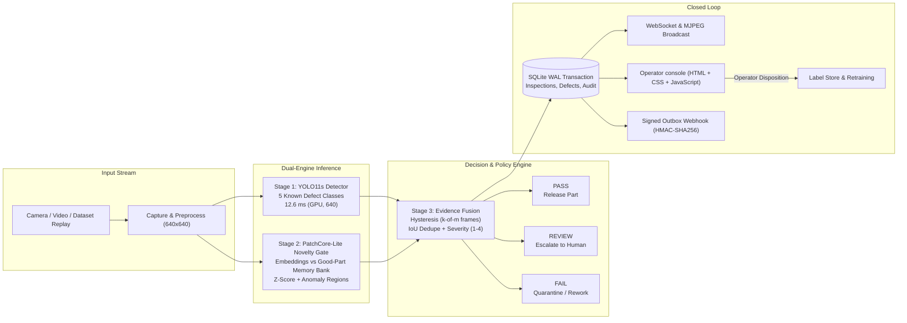

# Real-Time AI Quality Assurance & Defect Detection — Indore QA Cell

An industrial single-camera surface inspection cell that detects and classifies manufacturing defects live, returns **PASS / REVIEW / FAIL** verdicts, and escalates **unseen defect types to human review instead of force-classifying them** on profiles whose novelty gate is trusted (currently `bottle`, `metal_nut`, and `transistor`; the steel gate is not validated and does not gate).

Built and benchmarked for an RTX 4060 Laptop (8 GB VRAM) / 32 GB RAM / Windows workstation. The server loads the PyTorch weights; the ONNX artifact is exported, but its 640 CPU path is pending a fresh export and benchmark.

---

## 1. Quickstart

### Option A: One-Click Launch (Windows)
Double-click `DEMO.bat` or run in terminal:
```bat
DEMO.bat
```

### Option B: PowerShell
```powershell
.\scripts\demo.ps1
```

### Real YOLO + image or video presentation
Use the strict launcher with a local image or video:
```powershell
.\scripts\demo_input.ps1 -InputPath "C:\path\to\inspection-demo.mp4"
# Or: .\scripts\demo_input.ps1 -InputPath "C:\path\to\defect.jpg"
```
It requires promoted YOLO weights, preloads the model before startup, selects the input type, and uses strict real-detector mode so a fixture cannot silently replace YOLO. The previous `demo_video.ps1 -VideoPath` command remains available. The Live page also accepts an image or video. Uploaded images are inspected repeatedly in the live view; video clips play in a loop. The trained detector draws overlays. Image uploads are limited to 20 MB; video uploads to 500 MB.

### Option C: Manual CLI
```bash
# 1. Install dependencies
pip install -r requirements.txt

# 2. Build Web UI
cd web && npm install && npm run build && cd ..

# 3. Start server
python -m uvicorn server.app.main:app --host 127.0.0.1 --port 8000
```
- **Operator Web Dashboard**: [http://127.0.0.1:8000](http://127.0.0.1:8000)
- **Interactive OpenAPI Docs**: [http://127.0.0.1:8000/docs](http://127.0.0.1:8000/docs)
- **Live MJPEG Stream**: [http://127.0.0.1:8000/live.mjpg](http://127.0.0.1:8000/live.mjpg)

---

## 2. Architecture & Pipeline



---

## 3. Measured Model Accuracy

All detector numbers below are measured on the **225-image NEU-DET test split** with **NMS IoU 0.6** and **`rect=False` (deployment preprocessing)**; mAP@50-95 uses the standard 0.50:0.95 matching. mAP is computed from the full precision-recall curve (`conf=0.001`). Precision/Recall are at the fixed operating confidence **0.25**. Weights: `artifacts/models/detector_best.pt`, SHA-256 `7b694d7e9f020b4171e128e6bd860963e8820eaacf08c74dba458f3d8495f47a`.

> **Current status (2026-10-31):** The pitted-surface hard-negative fine-tune was promoted after correcting the clean-frame false-alarm rate. It meets the FPR target of ≤15% (11.0% at conf 0.25) with zero crazing false alarms, and achieves overall **0.7855 mAP50 / 0.3961 mAP50-95** at 640, operating confidence **0.25**. Previous weights are preserved under `artifacts/models/legacy/`. Full record: `artifacts/eval/pitted_promotion_decision.json`.

> **Protocol correction:** earlier tables in this project used Ultralytics `rect=True` validation, which reports inflated mAP on this dataset. All deployment numbers use `rect=False`. The 1024 + TTA benchmark is an offline option only.

### Deployment path: 640×640, no TTA

| Defect Class | Images | Precision | Recall | mAP@50 | mAP@50-95 |
|---|---|---|---|---|---|
| **patches** | 45 | 85.3% | 80.8% | **0.879** | 0.511 |
| **scratches** | 45 | 84.8% | **88.7%** | **0.907** | 0.384 |
| **inclusion** | 45 | 78.0% | 68.5% | **0.792** | 0.362 |
| **pitted_surface** | 45 | **90.1%** | 71.1% | **0.798** | 0.470 |
| **crazing** | 45 | 51.9% | 34.3% | **0.449** | 0.155 |
| **ALL KNOWN CLASSES** | **225** | **71.9%** | **74.7%** | **0.7855** | **0.3961** |

Crazing remains the weak class: it is diffuse, low-contrast, and hard to localize. It is not rare by instance count. The augmented retrain improved four of five classes at 640 but reduced crazing mAP50 from 0.432 to 0.390.

### Benchmark-only path: 1024×1024 + TTA

| Configuration | mAP@50 | mAP@50-95 | Model inference |
|---|---:|---:|---:|
| **640 plain (deployment)** | **0.7855** | 0.3961 | **62.2 ms** |
| **1024 + TTA (benchmark)** | **0.774** | **0.397** | **34.5 ms** |

Both rows use `rect=False`. TTA is only valid at the resolution the model was trained at. At 640 it reduces accuracy. The 1024 + TTA gain over 640 is **+2.1 mAP50** for the promoted model. The 640 + TTA and 1024 plain configurations are not part of the current protocol and are not quoted until re-run with `rect=False`.

### Retrain comparison (same corrected protocol)

| Weights | 640 mAP50 | 640 mAP50-95 | 1024+TTA mAP50 | 1024+TTA mAP50-95 |
|---|---:|---:|---:|---:|
| Previous promoted (legacy) | 0.740 | 0.352 | **0.783** | **0.400** |
| **1,470-image retrain (promoted)** | **0.753** | **0.373** | 0.774 | 0.397 |

The pitted-surface fine-tune gains 0.033 mAP50 on the 640 deployment path while fixing the FPR from 18.8% to 11.0% at conf 0.25. The 1024+TTA benchmark numbers are unchanged because the model was trained at 640.

### Novelty gate: what is actually validated

`rolled-in_scale` (300 images) was never trained on, so detector leakage is zero. That does **not** prove the steel gate escalates it: on held-out data the steel gate scores **AUROC 0.632** (crazing 0.559, pitted_surface 0.551), and its built-in separation check is negative. The server therefore marks steel `not_validated`; with no detections it releases the part and records `gate_does_not_gate_this_profile`.

The novelty demo uses profiles whose gates have validated defect-vs-good separation:

| Profile | Gate AUROC | Quality | Gate trusted? |
|---|---:|---|---|
| **bottle** | 0.996 | strong | Yes |
| **metal_nut** | 0.973 | strong | Yes |
| **transistor** | 0.942 | good | Yes |
| **screw** | 0.611 | marginal | No |
| **steel** | 0.632 | not_validated | No |

Trust is derived from the defect-vs-good separation because the manifest `unknown` splits were not re-scored during summary rehydration. The gate-policy check in `OPTIMIZATION_CONTEXT.md` therefore verifies the **routing rule**, not a per-profile unknown-set AUROC. Bottle and metal_nut remain the strongest novelty demos.

---

## 4. Hardware & Latency Benchmarks

All figures measured batch-1 on the actual test rig (**Intel Core i7-14700HX, RTX 4060 Laptop 8GB, 32GB RAM, Windows 11**):

| Runtime Engine | Resolution | Precision | p50 Latency | p95 Latency | Sustained Throughput |
|---|---|---|---|---|---|
| **PyTorch (CUDA), 640** | 640×640 | FP16 | **12.6 ms** | **27.5 ms** | **79.2 FPS** |
| **PyTorch (CUDA), 1024 + TTA** | 1024×1024 | FP16 | **73.1 ms** | — | 13.7 FPS |
| **PatchCore Gate (CUDA)** | 256×256 | FP32 | **1.2 ms** | **3.8 ms** | 260+ FPS |
| **ONNX Runtime (CPU), 640** | 640×640 | FP32 | **62.2 ms** | **69.8 ms** | 16.1 FPS |

The shipped `artifacts/models/detector_best.onnx` is now a static **1×3×640×640 FP32** graph (37.9 MB) exported from the promoted weights. It validates at **0.7533 mAP50**, matching the PyTorch 640 deployment result. The ONNX row is batch-1 model inference with 4 CPU threads, not full-pipeline latency. The old static 1024 graph is preserved under `artifacts/models/legacy/` and is not the current deployment artifact.

Deployment defaults to the 640 PyTorch path. The 1024 + TTA path is an offline benchmark option because it is ~6× slower.

---

## 5. What is Real vs. What is Simulated

Following the project governance rule (*"fake the environment, never the measurement"*):

| Aspect | Status | Implementation Detail |
|---|---|---|
| **Defect Detection** | **100% Real** | YOLO11s trained weights (`artifacts/models/detector_best.pt` & `.onnx`). |
| **Novelty Gate** | **100% Real** | PatchCore-lite embedding distance against good-part memory banks. Validated and trusted on `bottle`, `metal_nut`, and `transistor`; the steel gate is not validated and is disabled. |
| **Latency & FPS** | **100% Measured** | Live per-stage waterfall instrumented on the screen (no simulated delays). |
| **Audit & Review State** | **100% Real** | SQLite WAL atomic transactions, signed MES webhooks with HMAC-SHA256 retry. |
| **Production Conveyor** | *Simulated* | Replays high-resolution frames from verified dataset profiles with camera fallback. |

---

## 6. Evaluation Protocol & Operating Threshold

Use one script for every comparison so numbers remain reproducible:

```powershell
python scripts/eval_canonical.py `
  --weights artifacts/models/detector_best.pt `
  --split test `
  --imgsz 640 `
  --conf 0.35 `
  --iou 0.6 `
  --out artifacts/eval/canonical_640.json
```

The script records the weights SHA-256, split, resolution, NMS IoU, the AP matching range (0.50:0.95), the mAP protocol, per-class metrics, and precision/recall at the chosen operating confidence. It defaults to **`rect=False`**, matching the server's `predict` path. `--rect` is retained only for legacy comparison; it inflates mAP on this dataset and must not be used for published numbers.

The server has **two confidence floors** that must agree:

- `INDORE_CONF` (default `0.35`) filters detections inside the detector.
- The SQLite threshold profile field `conf_min` (seeded `0.35`) filters tracks during fusion.

The active operating point is **0.35**, chosen for recall: 95.1% of test images get at least one detection, versus 88.4% at 0.55. The cost is clean-crop false fires: 18.8% at 0.35 versus 7.8% at 0.55. Held-out `rolled-in_scale` fires on 24.3% of images at 0.35 and 10.3% at 0.55. These are detector fire rates, not UNKNOWN escalations.

To override the default, set both floors:

```powershell
$env:INDORE_CONF = "0.45"
# with the server running:
Invoke-RestMethod -Method Patch http://127.0.0.1:8000/api/thresholds `
  -ContentType "application/json" `
  -Body '{"conf_min": 0.45}'
```

Changing only `INDORE_CONF` is not enough: the fusion stage still drops tracks below `conf_min`.

The web UI operating-point scan is current for the promoted weights. Regenerate it after any weight or resolution change:

```powershell
python scripts/scan_operating_points.py `
  --weights artifacts/models/detector_best.pt `
  --imgsz 640
```

---

## 7. Verification & Test Suite

Run the automated smoke test:
```bash
python scripts/smoke_test.py
```

Expected output:
```
[PASS] Python imports (fastapi, uvicorn, cv2, numpy, pydantic, torch)
[PASS] Server module imports
[PASS] Configuration and filesystem
[PASS] Promoted weights (detector_best.pt & detector_best.onnx)
[PASS] Web dist built
[PASS] Profiles loaded (5 profiles)
[PASS] Gate ready (device=cuda)
[PASS] SQLite WAL
[PASS] FrameResult JSON contract round-trip
[PASS] Overlay renderer (HUD & Clean modes)
[PASS] Heldout-class integrity (zero training leakage)
```

The smoke test also prints non-fatal warnings for the `steel` and `screw` gates. That is expected: both are intentionally untrusted because their separation is too weak to gate production.
