# Indore QA Cell — Complete Project Handoff

**Snapshot date:** 1 November 2026  
**Purpose:** Jury handoff, project transfer, and context for another AI assistant.  
**Repository root:** `Indore/`  
**Project:** Real-time AI quality assurance and defect detection for five product families.

> This document is the consolidated project brief. Some older files in the repository describe earlier model states. Use the timestamped evaluation artifacts and the current `/api/health`, `/api/datasets/unified`, and `/api/models.runtime` responses as the source of truth for the running system. Do not combine metrics from different models or dataset splits.

## 1. Executive summary

Indore QA Cell is a computer-vision inspection prototype. It accepts an image or video, identifies one of five supported product families, runs a defect detector, overlays defect names and boxes, assigns a prototype disposition, and saves evidence for operator review.

Supported product families:

1. Hot-rolled steel strip
2. Metal nut
3. Screw
4. Transistor
5. Bottle

The active local runtime observed on 1 November 2026 was using the **unified YOLO11s 21-class checkpoint** on CUDA. Its saved internal test result is **70.12% mAP50** and **49.14% mAP50–95** over 789 prepared test images. This is an internal prototype result, not production-camera accuracy. Most non-steel classes have only one to four positive test images, so their class-specific scores are highly uncertain.

The system also has a separate steel-only YOLO checkpoint, product-family identification, PatchCore-lite anomaly gates, a standalone M2 screw Body OK/NG classifier, a local optional vision-language advisor, a review queue, evidence records, CSV/ZIP reporting, and simulated PLC-style routing. These are separate components and their metrics must not be represented as one model score.

## 2. Problem and proposed solution

Manufacturing inspection needs to identify defects before defective components move to downstream processes. This prototype demonstrates how image/video analysis can return a named defect, a bounding box, model confidence, severity, and a review or disposition record.

The intended workflow is:

1. An operator uploads an image/video or watches the idle dataset replay.
2. The app tries to identify the product automatically.
3. If identity is uncertain or outside the supported scope, the upload is saved for **manual review** and defect inference is skipped.
4. If identity is accepted, the profile is selected and the unified detector runs.
5. The result is displayed with a class label, confidence, box, severity, and PASS / REVIEW / FAIL verdict.
6. The inspection and available evidence are stored; an operator can record a disposition and export a report.

The product-family identifier does not require the operator to select steel, nuts, screws, transistors, or bottles for a normal upload.

## 3. Scope: what the prototype does and does not claim

### Implemented

- Automatic product-family classification across the five supported families.
- A unified 21-class YOLO11s checkpoint and a profile-specific filtering layer.
- Image and video upload; video identity is selected from the first decoded frame.
- Manual review for unrecognized product uploads, with stored image evidence. For an unrecognized video, the first frame is saved as evidence and defect inference is skipped.
- Bounding boxes, defect names, confidence scores, severity rules, a review queue, inspection history, and audit records.
- Optional PatchCore-lite anomaly scores.
- Optional on-demand local VLM assistance for product confirmation and inspection advice.
- Rule-based reuse/repair/recycle suggestions, clearly advisory.
- Simulated PLC-style commands displayed in the UI.
- Dataset replay with five product families in sequential 10-image blocks.

### Not implemented or not validated as a production capability

- “Every object” or “every possible defect” recognition. The model is limited to the five trained product families and 21 named defect classes.
- Pixel segmentation or a calibrated percentage of the part’s surface that is damaged. Detector confidence is **not** damaged-area percentage. The severity heuristic uses bounding-box area fraction, which is also not a physical damage measurement.
- Remaining useful life, time until failure, electrical functionality, hygiene, material composition, or a guarantee that an item is safe to reuse.
- Physical PLC, conveyor stop, diverter, or reject-actuator control. The displayed action is simulated and is not sent to factory equipment.
- Production-line accuracy or generalization to a customer’s camera, lighting, geometry, speed, or materials.
- A validated guarantee that every unfamiliar defect is routed to a person. Unknown-product identity routes to review; novelty-gate performance for unseen defect classes is not independently validated across all products.

## 4. Current live state and model distinction

The local API was queried on 1 November 2026. It reported:

| Runtime field | Observed value |
|---|---|
| API | `ok`, version `1.0.0` |
| Detector mode | `unified` |
| Detector engine | `yolo11s-unified-pt` |
| Detector checkpoint | `artifacts/runs/unified_yolo11s_640/weights/best.pt` |
| Detector device | CUDA (`0`) |
| Input profile/source at query | bottle / image |
| Input size / detector confidence / NMS IoU | 640 / 0.25 / 0.60 |
| Fusion `conf_min` | 0.33 |
| FPS shown by health endpoint | about 12; configured target is 12 FPS, so this is a runtime snapshot, not a benchmark |
| Local VLM status | ready, `qwen2.5vl:3b` through Ollama |

There are **two different YOLO checkpoints**:

| Checkpoint | Scope | Result | Status |
|---|---|---|---|
| `artifacts/runs/unified_yolo11s_640/weights/best.pt` | Unified five-product detector, 21 classes | 0.7012 mAP50 / 0.4914 mAP50–95 on 789 prepared test images | Active in the observed runtime; current candidate for the five-product demo |
| `artifacts/models/detector_best.pt` | Steel-only NEU-DET detector, 5 classes | 0.7855 mAP50 / 0.3961 mAP50–95 on its separate 225-image NEU-DET test split | Promoted steel specialist; not the unified 21-class model |

The steel-only ONNX at `artifacts/models/detector_best.onnx` is also not the unified 21-class ONNX. Do not report the steel specialist’s score as the unified model’s score. The unified checkpoint is ignored by Git and must be copied into any deployment or handoff bundle separately.

**Unified model SHA-256:** `3e500b2d9b915f0d6c61433784376b9addfd7ae0abb4950f59623683e914388b`  
**Steel model SHA-256:** `7b694d7e9f020b4171e128e6bd860963e8820eaacf08c74dba458f3d8495f47a`  
**Product classifier SHA-256:** `375de347af1d45736c0942095d5e51bef2f36fd270c9cc03447d00ca41b98fd9`

## 5. End-to-end system and model flow

```mermaid
flowchart LR
  A[Image / video upload / dataset replay / camera source] --> B[Decode frame with OpenCV]
  B --> C[Automatic product-family classifier<br/>OpenCV HOG + color features, scikit-learn/joblib]
  C -->|Confident supported family| D[Select one of five product profiles]
  C -->|Uncertain / unsupported| R[Save evidence + create manual REVIEW<br/>Do not run defect inference]
  C -->|Near miss 0.45–0.55| V[Optional local Ollama Qwen2.5-VL confirmation]
  V -->|Same product + visual evidence + no uncertainty| D
  V -->|Unavailable / disagreement / uncertain| R
  D --> E[Unified YOLO11s, 640 px<br/>21 product-specific defect classes]
  D --> G[PatchCore-lite anomaly score<br/>profile memory bank]
  E --> F[Track and fuse detections across frames]
  G --> F
  F --> H[Severity + PASS / REVIEW / FAIL]
  H --> I[FastAPI service + SQLite evidence/audit]
  I --> J[Web console, review queue, CSV/ZIP reports]
  I --> K[Simulated PLC-style command<br/>display only; no physical equipment]
  J --> L[Optional, on-demand VLM advisory<br/>Reuse candidate / Inspect or repair / Recycle candidate]
```



### 5.1 Upload and product identification

- The browser sends raw image/video bytes to `PUT /api/input?filename=...`.
- The backend validates size/type and decodes the image or first video frame with OpenCV.
- `AutoProfileClassifier` reads `artifacts/models/auto_profile_classifier.joblib`. It uses an image feature vector built from HOG-like shape features and HSV color histogram features, followed by a scikit-learn classifier.
- The default classifier floor is 0.55. The scoped-family evaluation accepted 97.5% of supported-family images correctly and rejected 96.1% of the available out-of-scope evaluation images. These figures do not include the local VLM rescue path and do not measure performance on arbitrary camera domains.
- For a narrow score band from 0.45 to below 0.55, an available local VLM can rescue identification only when it names the same supported product and provides at least two visual cues with no stated uncertainty. This result receives a domain warning.
- If the product is still unrecognized/uncertain, the backend stores the uploaded evidence, creates a `review` inspection with reason `product_not_recognized`, records no defect detections, and routes to the review queue. This is the behavior used for the unsupported-human-image case.
- If identity is accepted, the backend selects one of: `steel`, `metal_nut`, `screw`, `transistor`, `bottle`.

### 5.2 Defect detector

- Implementation: Ultralytics YOLO11s object detector, initialized from pretrained `yolo11s.pt` and fine-tuned on the prepared 21-class dataset.
- Input size: 640 × 640.
- Runtime NMS IoU: 0.60.
- Runtime detector confidence setting observed: 0.25; fusion rejects tracks below the active DB `conf_min` of 0.33. Effective accepted confidence therefore depends on both settings.
- Unified detector profile filtering uses class prefixes, e.g. `steel_` or `bottle_`, then returns the profile-local class name to the UI.
- Output: class name, confidence score, bounding-box coordinates, source/model metadata, and severity/routing data.
- Confidence is the detector’s score for its prediction. It is not a percent of the object that is damaged.

### 5.3 PatchCore-lite anomaly gate

- Extracts image embeddings with a Wide ResNet-50-2 backbone and compares patches against a profile memory bank (4,000 bank vectors per profile in the gate summary).
- Returns an anomaly score and regions; it does not name a trained defect class.
- Gate status is profile-specific. Current good-vs-known-defect separation checks are:

| Product profile | Separation score | Gate quality | Trusted by runtime? | Important caveat |
|---|---:|---|---|---|
| Bottle | 2.787 | Strong | Yes | The unknown-class split was not re-scored in the rehydrated summary |
| Metal nut | 1.723 | Strong | Yes | The unknown-class split was not re-scored in the rehydrated summary |
| Transistor | 0.939 | Good | Yes | The unknown-class split was not re-scored in the rehydrated summary |
| Screw | 0.279 | Marginal | No | Informational; it does not drive critical routing |
| Steel | −0.127 | Not validated | No | Negative separation; it must not be presented as an effective steel novelty gate |

These are defect-vs-good separation checks, **not** verified AUROC results on unseen defect families. The reported historical AUROC values (bottle 0.996, metal nut 0.973, transistor 0.942, screw 0.611, steel 0.632) are included in the gate audit; the unknown sets were not all re-scored during summary rehydration.

### 5.4 Tracking, fusion, severity, and routing

- Detection boxes of the same class are associated across frames at IoU ≥ 0.45.
- When a part spans more than two frames, a detection needs at least `max(2, ceil(frame_count × 0.25))` frame votes. Parts with at most two frames need one vote.
- Track confidence is the median confidence of its boxes. Detector and fusion confidence floors both apply.
- Severity is 1–4. The current heuristic combines a class base severity, normalized **box** area bands, and a confidence adjustment. It is a demo policy, not a calibrated engineering risk scale.
- If a supported, sufficiently stable known defect remains, verdict is FAIL; severity 4 routes to quarantine/hold, severity 3 to rework, and lower severity to release with a note.
- Ambiguous/transient detections or elevated novelty on a trusted gate can route to REVIEW. A clean result can PASS. If the profile gate is untrusted, it does not escalate a no-detection result.
- The operator can record `true_defect`, `false_alarm`, or `reclassify` dispositions; changes are added to audit history.

### 5.5 Simulated PLC-style route

The interface displays an advisory command only. The code does not connect to a physical PLC:

| Rule, in order | Simulated command | Displayed action |
|---|---|---|
| FAIL and severity 4 | STOP | Hold line for inspection |
| FAIL with scratch confidence ≥ 0.80 | MARK | Hold part for review |
| FAIL and severity 3 | DIVERT | Send to quality inspection lane (simulated) |
| Other FAIL or REVIEW | MARK | Hold part for review |
| PASS | LOG | Release part (display only) |

The output includes `demo_only: true`.

### 5.6 Optional VLM and reuse/recycle advice

- The configured local model is `qwen2.5vl:3b` served by Ollama, normally at `http://127.0.0.1:11434`.
- The live YOLO inference path does not wait for the VLM. Product confirmation is a narrow near-miss exception. The separate “Analyze completed inspection” action calls the VLM on demand after a completed inspection.
- The VLM returns a structured view of condition, visual evidence, uncertainty, and its own suggestion. A separate deterministic rule produces the displayed route: `Reuse candidate`, `Inspect or repair`, or `Recycle candidate`. Disagreement signals human review.
- Neither the VLM nor the rule has a measured reuse/recycle accuracy dataset. These labels are advisory, not certifications; they cannot establish mechanical strength, electrical function, sanitation, composition, safety, or time to failure.
- This feature does not change YOLO weights or mAP.

## 6. Defect taxonomy: all 21 classes

Class IDs and names are defined by `data/defect_taxonomy.json` and the unified dataset `data.yaml`. Preserve this order when preparing YOLO labels.

| ID | Product family | YOLO class name | Human-readable class |
|---:|---|---|---|
| 0 | Steel | `steel_crazing` | Crazing |
| 1 | Steel | `steel_inclusion` | Inclusion |
| 2 | Steel | `steel_patches` | Patches |
| 3 | Steel | `steel_pitted_surface` | Pitted surface |
| 4 | Steel | `steel_scratches` | Scratches |
| 5 | Metal nut | `metal_nut_bent` | Bent |
| 6 | Metal nut | `metal_nut_color` | Color defect |
| 7 | Metal nut | `metal_nut_flip` | Flip / orientation defect |
| 8 | Metal nut | `metal_nut_scratch` | Scratch |
| 9 | Screw | `screw_manipulated_front` | Manipulated front |
| 10 | Screw | `screw_scratch_head` | Scratch head |
| 11 | Screw | `screw_scratch_neck` | Scratch neck |
| 12 | Screw | `screw_thread_side` | Thread side defect |
| 13 | Screw | `screw_thread_top` | Thread top defect |
| 14 | Transistor | `transistor_bent_lead` | Bent lead |
| 15 | Transistor | `transistor_cut_lead` | Cut lead |
| 16 | Transistor | `transistor_damaged_case` | Damaged case |
| 17 | Transistor | `transistor_misplaced` | Misplaced component |
| 18 | Bottle | `bottle_broken_large` | Broken large |
| 19 | Bottle | `bottle_broken_small` | Broken small |
| 20 | Bottle | `bottle_contamination` | Contamination |

## 7. Datasets: used, separately evaluated, or not merged

### 7.1 Datasets used in the unified 21-class detector

#### NEU-DET (hot-rolled steel)

- Source: Northeastern University’s NEU surface defect database. Original set: about 1,800 200×200 grayscale images, six categories with about 300 images each.
- Classes in source order: crazing, inclusion, patches, pitted surface, rolled-in scale, scratches.
- Unified detector uses five labeled steel classes. `rolled-in_scale` is withheld from the steel model training split and is not one of the unified 21 classes.
- Frozen base split uses seed 42: 1,050 original training images (210 for each trained class), 225 validation images (45 each), 225 test images (45 each), and 300 held-out rolled-in-scale images.
- The working steel training set has 420 additional train-only synthetic crazing augmentations, making the image count 1,470 before the clean image bank is added. The base split manifest records the original 1,050 training set; do not mistake that manifest count for the augmented working-directory count.
- Clean NEU-GOOD crops support anomaly-bank/calibration evaluation and contribute empty-label examples to the combined detector dataset.
- License: no clear upstream license is stated in the project intake. Treat it as research use and do not claim commercial rights without checking with the dataset owner.

#### MVTec Anomaly Detection (MVTec AD)

- Official dataset: 15 product/texture categories, over 5,000 high-resolution images, defect-free training examples, test examples, and pixel-level anomaly masks.
- The combined YOLO dataset uses the `metal_nut`, `screw`, `transistor`, and `bottle` categories. Their masks were converted into connected-component bounding boxes. Good images receive empty YOLO label files.
- Source defect images originally came from MVTec AD test folders and were re-partitioned at approximately 70/15/15 for this new prototype. Therefore, the unified test result is **not** the canonical MVTec benchmark result and is not a fresh independent production test.
- MVTec AD is licensed **CC BY-NC-SA 4.0**. The official terms prohibit commercial use without appropriate permission. Do not place it in a public or commercial product bundle unless the license permits that use.

### 7.2 Unified dataset split totals

Prepared dataset location: `artifacts/datasets/unified_defects/`. `manifest.json` records source paths and label provenance; the YAML is `artifacts/datasets/unified_defects/data.yaml`.

| Profile | Train images | Validation images | Test images | Total |
|---|---:|---:|---:|---:|
| Steel | 3,143 | 593 | 598 | 4,334 |
| Metal nut | 219 | 46 | 48 | 313 |
| Screw | 308 | 66 | 65 | 439 |
| Transistor | 177 | 40 | 36 | 253 |
| Bottle | 190 | 40 | 42 | 272 |
| **All profiles** | **4,037** | **785** | **789** | **5,611** |

| Split | Images | Bounding boxes |
|---|---:|---:|
| Train | 4,037 | 3,701 |
| Validation | 785 | 621 |
| Test | 789 | 587 |

The 4,037/785/789 split includes empty-label clean images. The raw NEU images, MVTec good images, and MVTec defect-mask conversions are combined under one taxonomy. Do not call these 5,611 unique factory captures.

### 7.3 MVTec-derived PatchCore profiles

The good/defect gate banks are separate from YOLO’s object labels. Current profile inventory observed through `/api/profiles`:

| Profile | Good images | Known/unknown defect images in profile inventory | Bank images/crops | Calibration frames |
|---|---:|---:|---:|---:|
| Steel | 373 | 225 known + 300 held-out unknown | 1,673 bank crops | 368 |
| Metal nut | 33 | 93 | 154 | 33 |
| Screw | 48 | 119 | 224 | 48 |
| Transistor | 32 | 40 | 149 | 32 |
| Bottle | 32 | 63 | 146 | 31 |

Gate inputs, evaluation partitions, and trust are documented in `data/profiles/manifest.json` and `artifacts/models/gate_summary.json`. For non-steel MVTec profiles, the summary was rehydrated from existing banks and the unknown set was not re-scored.

### 7.4 Other downloaded/intaken datasets — not used to train the active 21-class YOLO

#### M2 screw defect dataset v2 (Mendeley Data)

- Source: [M2 screw defect detection dataset v2](https://data.mendeley.com/datasets/2y6mcsyrpy/2), DOI `10.17632/2y6mcsyrpy.2`, CC BY 4.0.
- BODY archive was downloaded and extracted locally: Body Train 1,000 OK + 1,000 NG; Body Test 500 OK + 500 NG; images are BMP, 1024×1280. The source has image-level OK/NG labels, not defect subtype boxes/masks.
- The Head archive was not downloaded. `BARI` NG examples appear to include altered threads, but no reliable mapping to the 21 named defect classes is supplied.
- An annotation queue of 60 train NG + 20 train OK images was created. After a first 37-image review, three tentative manipulated-front boxes were kept as provisional examples; the remaining reviewed images were not accepted for unified detector training. No M2 boxes were merged into the 21-class dataset.
- A separate Body OK/NG ResNet18 classifier was trained; see §10. This classifier does not produce defect boxes or defect subtype names.

#### AnywayLabs synthetic MVTec-style screw/transistor data

- Dataset card: `anywaylabs/synthetic-mvtec-ad-defect-detection`, pinned to revision `554be045cd0ee0efe847bacbd61cf2e4c31992a5`.
- Downloaded selection includes 250 screw synthetic train images and 200 transistor synthetic train images with labels; source validation files overlap MVTec source IDs already re-partitioned into the unified dataset.
- The synthetic boxes are substantially broader than current component/mask boxes for several screw classes (for example, median `thread_side` box-area ratio about 18× the current unified label convention). They were not merged, trained on, or counted as new independent examples.
- Source card lists CC BY 4.0, but derivative data’s relationship to MVTec’s non-commercial terms needs licensing review before redistribution or commercial use.

### 7.5 Other dataset directories in the parent workspace

The parent folder also contains directories named `gc10det`, `severstal-steel-defect-detection`, `MPDD`, `visa`, `sheet_metal`, `laserMicroscope_unagedBakelite`, `NEUDATA`, and `mvtec_anomaly_detection`. Their presence on this workstation does **not** prove they were used in the active 21-class training run. The active unified run’s source provenance is in its dataset manifest. Do not claim these as training sources without adding them to a reproducible manifest and training record.

## 8. Model training record and promotion decisions

### 8.1 Unified YOLO11s, active five-product candidate

- Initial weights: pretrained `yolo11s.pt`.
- Task: object detection, 21 classes.
- Training YAML: `artifacts/datasets/unified_defects/data.yaml`.
- Run: `artifacts/runs/unified_yolo11s_640/`.
- Input size: 640; batch 8; device 0; seed 42; pretrained true; deterministic true; AMP enabled; 100-epoch budget; best epoch by training fitness: 82.
- Main augmentation settings from the saved run: mosaic 1.0, scale 0.5, horizontal flip 0.5, erasing 0.4, no rotation, close mosaic for final 10 epochs. The run’s Ultralytics optimizer setting is `auto`; do not assume a different optimizer without checking the saved run logs.
- Training split: 4,037 images, 3,701 boxes. Validation: 785 images. Test: 789 images.
- Saved checkpoint SHA-256 is listed in §4.
- A later exact-duplicate audit found one train/validation duplicate: `train/steel__patches_101.jpg` vs `val/steel__patches_105.jpg`. An isolated fine-tune data list excluded the train copy, but the already-trained baseline used it, so its validation score retains this historical leakage. Do not alter test or claim fully leakage-free validation.

### 8.2 Latest controlled experiments — not promoted

- A one-epoch low-learning-rate smoke fine-tune was initialized from the saved checkpoint, excluded the exact duplicate from training, and kept labels/test unchanged.
- On the controlled rectangular-batching validation procedure, saved baseline was 0.7604 all-class mAP50 and 0.7596 five-steel-class macro AP50. The smoke checkpoint was 0.7457 and 0.7194, respectively. The preregistered gate required both primary metrics within 0.02; steel macro fell by 0.0402, so the gate failed and no treatment run proceeded.
- A later gentle fine-tune reached only 0.5410 validation mAP50 and was stopped after four complete epochs. It was not promoted or tested.
- The 960-pixel baseline validation result was 0.5779 mAP50, below 640 for this validation protocol. Keep 640 for the current model.
- The active checkpoint and its earlier test result remain unchanged. Do not use an unpromoted checkpoint or report it as the active model.

### 8.3 Separate steel-only detector

- `artifacts/models/detector_best.pt` was promoted for the NEU-DET five-class task after a pitted-surface hard-negative fine-tune.
- Fine-tune: initialized from real-only steel checkpoint; 30 epochs; batch 8; `lr0=0.001`; 1,050 original training images + 350 clean hard-negative crops; operating size 640.
- Test metrics: 0.7855 mAP50 / 0.3961 mAP50–95 across 225 NEU-DET images; operating confidence 0.25; NMS IoU 0.60. The separate test result is in `artifacts/eval/canonical_promoted_calibrated_test_20261030.json` and promotion decision in `artifacts/eval/pitted_promotion_decision.json`.
- Clean calibration frame false-alarm rate was 11.0% at confidence 0.25 in the promoted decision record, with zero observed crazing false alarms. This result applies to the clean calibration bank, not an arbitrary factory stream.
- This checkpoint is a different five-class steel model. It does not improve or replace the 21-class model metrics.

## 9. Present detector metrics: unified 21-class model

### 9.1 Overall internal test metrics

Evaluation source: `artifacts/eval/unified_yolo11s_640_test.json`.

| Metric | Result |
|---|---:|
| Test images | 789 |
| Number of trained classes | 21 |
| Precision | 0.8109 (81.1%) |
| Recall | 0.6201 (62.0%) |
| mAP50 | **0.7012 (70.1%)** |
| mAP50–95 | **0.4914 (49.1%)** |
| Input size | 640 |
| NMS IoU | 0.60 |
| Confidence used to rank mAP predictions | 0.001 |

The test result is a prepared internal split whose MVTec defect images were reassigned from the source anomaly-test folders. Several classes have only 1–4 positive test images. It is useful as a prototype baseline, but it is not a canonical MVTec benchmark score or credible production-camera estimate. The test score was already known during the later model-improvement work; do not call it a new blind evaluation.

### 9.2 Per-class internal test results

`Positive images` is the number of test images containing that class; `GT boxes` is the number of labeled instances. Very small n makes apparent scores near 1.0 especially unreliable.

| Class | Positive images | GT boxes | Precision | Recall | mAP50 | mAP50–95 |
|---|---:|---:|---:|---:|---:|---:|
| Steel crazing | 45 | 99 | 50.8% | 37.6% | 0.436 | 0.141 |
| Steel inclusion | 62 | 149 | 78.7% | 71.1% | 0.829 | 0.463 |
| Steel patches | 52 | 137 | 91.7% | 81.6% | 0.918 | 0.579 |
| Steel pitted surface | 45 | 64 | 92.9% | 64.1% | 0.827 | 0.526 |
| Steel scratches | 45 | 82 | 91.0% | 91.5% | 0.961 | 0.615 |
| Metal nut bent | 3 | 4 | 87.7% | 100.0% | 0.995 | 0.758 |
| Metal nut color | 4 | 5 | 96.0% | 80.0% | 0.795 | 0.628 |
| Metal nut flip | 4 | 4 | 89.9% | 100.0% | 0.995 | 0.964 |
| Metal nut scratch | 4 | 6 | 63.6% | 33.3% | 0.534 | 0.286 |
| Screw manipulated front | 3 | 5 | 100.0% | 0.0% | 0.074 | 0.027 |
| Screw scratch head | 3 | 3 | 99.4% | 100.0% | 0.995 | 0.387 |
| Screw scratch neck | 3 | 3 | 70.4% | 66.7% | 0.830 | 0.515 |
| Screw thread side | 4 | 6 | 23.9% | 16.7% | 0.125 | 0.063 |
| Screw thread top | 4 | 4 | 77.7% | 25.0% | 0.345 | 0.080 |
| Transistor bent lead | 1 | 1 | 100.0% | 0.0% | 0.000 | 0.000 |
| Transistor cut lead | 1 | 1 | 66.0% | 100.0% | 0.995 | 0.995 |
| Transistor damaged case | 1 | 1 | 100.0% | 0.0% | 0.497 | 0.298 |
| Transistor misplaced | 1 | 1 | 75.4% | 100.0% | 0.995 | 0.995 |
| Bottle broken large | 3 | 3 | 68.7% | 74.9% | 0.830 | 0.670 |
| Bottle broken small | 4 | 5 | 79.2% | 76.9% | 0.755 | 0.560 |
| Bottle contamination | 3 | 4 | 100.0% | 83.0% | 0.995 | 0.770 |

### 9.3 Evaluation terminology

- **mAP50**: mean average precision using a box match threshold of IoU 0.50.
- **mAP50–95**: average AP over IoU thresholds 0.50 through 0.95; it demands more precise localization.
- **Precision/recall** depend on an operating confidence point; the JSON records the evaluation outputs. The mAP ranking uses prediction confidence 0.001 so the full precision-recall curve can be evaluated.
- UI confidence is a threshold for showing/accepting a detection. Changing it can change visible results but does not retrain the model or improve mAP.
- Do not compare values from different model checkpoints, data splits, `rect` modes, image sizes, NMS thresholds, or class sets as though they were the same experiment.

## 10. Other measured components

### 10.1 Product-family classifier

- Active weights: `artifacts/models/auto_profile_classifier.joblib`.
- Evaluation record: `artifacts/eval/auto_profile_scope_candidate.json`.
- Supported-family acceptance/correct identification: 97.5% on the prepared supported-family split.
- Out-of-scope rejection: 96.1% on the available MVTec out-of-scope evaluation images.
- All ten guided demo images routed to their intended family.
- Limit: VLM-rescued cases were not included in these metrics; the classifier has not been validated on arbitrary user images, packaging, new cameras, or changed backgrounds.

### 10.2 M2 screw Body OK/NG classifier — separate experiment

- Task: binary OK-vs-NG classification of M2 screw Body-camera images only. It does not identify a defect subtype and does not output a box.
- Data: 1,600 train images (800 OK, 800 NG), 400 validation images (200/200), and a sealed 1,000-image Body Test split (500/500).
- Model: ImageNet-pretrained ResNet18; fixed crop `(350,450,670,870)` from 1024×1280 input, resized to 224×224; AdamW `1e-4`; seed 42; best epoch 6 selected by validation ROC AUC.
- Validation-selected operating threshold: 0.781096, targeting ≤5% validation OK false alarms.
- Frozen test: ROC AUC 0.9846; accuracy 94.6%; balanced accuracy 94.6%; NG precision 93.1%; NG recall 96.4% (482/500); OK false-alarm rate 7.2% (36/500); missed NG 18/500.
- The generic 0.5 threshold produced 33.2% OK false alarms; report the calibrated 0.781096 threshold when quoting the 94.6% test accuracy.
- Domain masking diagnostic indicates some scene/background dependence: screw-region-only AUC 0.9945; background-only AUC 0.8275. It is not validated for arbitrary screws or cameras.
- API: `GET /api/m2-body/status`; `PUT /api/m2-body/classify`; dedicated page `/m2-body.html`. It accepts only 1024×1280 compatible inputs and is not merged into the main 21-class inference path.
- Checkpoint SHA-256: `ed434cdd92c28fac772f56b6cabaa0e190a0dc12551738cf3faaf9b5d18caefd`.

### 10.3 Local VLM

The VLM is an optional service integration, not a trained project detector. It uses a local Ollama model. No VLM defect-class accuracy or reuse/recycle agreement metric has been established. Do not attribute YOLO’s mAP to the VLM.

## 11. Application, data storage, and reports

### Frontend

- The live backend serves the current static console from `web/dist/index.html`.
- Current page source is primarily in `web/public/index.html`, `styles.css`, `app.js`, `app-integration.js`, and `integration.css`.
- `web/src/` and `web/original-react-entry/` contain an alternate/earlier React frontend. Check the actual served `web/dist/index.html` before changing UI code; do not assume every visible page is built from `web/src`.
- UI pages include input, live inspection, review queue, metrics, datasets, audit, settings, and M2 Body check.

### Backend and persistence

- FastAPI + Uvicorn API; Pydantic request/result schemas.
- SQLite database with WAL mode stores inspection summaries, detections, operator dispositions, audit entries, thresholds, model metadata, and an outbox.
- Evidence store writes source/annotated/crop/heatmap images where available and records hashes/metadata.
- WebSocket and MJPEG endpoints supply live frames.
- MES outbox uses HMAC-SHA256 signing, retries, and dead-letter behavior. A receiver can be demonstrated, but this is not a PLC connection.

### Main API routes

| Function | Routes |
|---|---|
| Health/runtime | `GET /api/health`, `GET /api/config`, `GET /api/models` |
| Product profiles/data | `GET /api/profiles`, `GET /api/profiles/{profile_id}`, `GET /api/datasets/verify`, `GET /api/datasets/unified`, `GET /api/datasets/image` |
| Image/video upload | `PUT /api/input`, `PUT /api/video` |
| Live frames | `GET /api/frames/latest`, `GET /api/frames/recent`, `GET /live.mjpg`, WebSocket `/ws/live` |
| Control | `POST /api/control`, `GET /api/control/state` |
| Inspection/review | `GET /api/inspections`, `GET /api/inspections/{inspection_id}`, `GET /api/review/queue`, `POST /api/inspections/{inspection_id}/review` |
| Metrics/audit | `GET /api/metrics`, `GET /api/audit`, `GET /api/eval/summary` |
| Reports | `GET /api/report`, `/api/report.csv`, `/api/report.zip`, `/api/export/inspections.csv` |
| Gate/threshold | `GET /api/gate/summary`, `GET/PATCH /api/thresholds` |
| VLM | `GET /api/vlm/status`, `POST /api/vlm/advice` |
| M2 Body | `GET /api/m2-body/status`, `PUT /api/m2-body/classify` |
| MES outbox | `/api/outbox`, `/api/outbox/status`, `/api/outbox/flush`, `/api/outbox/{outbox_id}/retry`, `/api/mes/events` |

### Report semantics

- An uploaded-image report uses the normal inspected input; for video, results are stored from the first processing pass, up to 2,000 inspection records.
- Export CSV stores detection/inspection rows with decision and evidence URLs. The images ZIP contains CSV, `summary.json`, and available source/annotated/crop/heatmap evidence.
- Counts are detection records, not deduplicated physical defects or parts. The app does not calculate coil distance in metres; that needs a line encoder.
- A very short clip that does not finish a part can have no completed record.
- Replay detections and decisions are demo activity, not independent evaluation measurements.

## 12. Idle dataset replay behavior

With `INDORE_DETECTOR=unified`, `INDORE_SOURCE=dataset`, and `INDORE_SEQUENCE=mixed`, the dataset replay presents **10 steel samples, then 10 metal nuts, then 10 screws, then 10 transistors, then 10 bottles**, and repeats. Within each family’s block, clean and defect examples alternate. Here `mixed` refers to the mix inside each product block; it does **not** interleave the five product families. These are still images replayed as a stream, not camera footage.

An uploaded image/video takes over the feed after identity handling. The Replay control returns to the dataset stream.

## 13. Technology stack

| Layer | Technology |
|---|---|
| Object detection | Ultralytics YOLO11s, PyTorch |
| Anomaly score | PatchCore-lite, Wide ResNet-50-2 embeddings, per-profile memory banks |
| Product identification | OpenCV, HOG/color features, scikit-learn/joblib |
| Optional vision-language service | Ollama + Qwen2.5-VL 3B, local and on-demand |
| Optional M2 classifier | PyTorch/Torchvision ResNet18 |
| Image/video processing | OpenCV, NumPy |
| API/server | Python 3.11+ compatible dependencies, FastAPI, Uvicorn, Pydantic |
| Database | SQLite WAL |
| Frontend | HTML, CSS, JavaScript in the currently served public build; Vite tooling and alternate React source also exist |
| Runtime | CUDA on the local NVIDIA laptop, CPU fallback for Render |
| Export | PyTorch `.pt`, steel-only ONNX `.onnx`, CSV/ZIP inspection reports |

See `requirements.txt` and `web/package-lock.json` for the dependency constraints. Python requirements use version ranges; they are not a fully locked cross-platform environment.

## 14. Run locally on another Windows machine

### 14.1 Required files

The Git repository alone is **not a complete runnable handoff**. `.gitignore` excludes `data/`, `artifacts/`, `runs/`, model weights, ONNX, databases, and `web/dist/`. Copy or restore the matching model/data artifacts separately, preserving the listed directory structure and hashes.

For the five-product unified demo, the minimum required assets are:

1. `artifacts/runs/unified_yolo11s_640/weights/best.pt` (21-class checkpoint; verify SHA-256 from §4).
2. `artifacts/models/auto_profile_classifier.joblib`.
3. Per-profile gates in `artifacts/models/gate_{steel,metal_nut,screw,transistor,bottle}.npz` plus `gate_summary.json`, if anomaly scoring is enabled.
4. The profile manifest and input datasets under `data/`, if using dataset replay/verification.
5. `artifacts/datasets/unified_defects/` if training/evaluation/reproducibility is needed. The active model can infer without retaining the full training set, but the data YAML and inputs are required to reproduce evaluation/training.
6. The built frontend at `web/dist/`, or Node/npm to regenerate it.
7. For the separate screw Body page only: `artifacts/runs/m2_body_resnet18_v1/best.pt`.
8. For the VLM feature only: install Ollama and pull `qwen2.5vl:3b`.

Never transfer the local SQLite database or captured user evidence unless there is a specific need and permission. Do not include `.env` files, Render passwords, signing keys, or local upload artifacts in a public bundle.

### 14.2 Setup and start

From the project root (`Indore/`):

```powershell
python -m venv .venv
.\.venv\Scripts\Activate.ps1
python -m pip install --upgrade pip
pip install -r requirements.txt

cd web
npm ci
npm run build
cd ..

$env:INDORE_DETECTOR = "unified"
$env:INDORE_DEVICE = "auto"
$env:INDORE_PROFILE = "steel"
$env:INDORE_SOURCE = "dataset"
$env:INDORE_SEQUENCE = "mixed"
python -m uvicorn server.app.main:app --host 127.0.0.1 --port 8000
```

Open `http://127.0.0.1:8000`; API docs are at `http://127.0.0.1:8000/docs`. Use the `unified` detector mode for five-product YOLO inference. Default mode `auto` can select the promoted steel-only checkpoint or a fallback depending on what artifacts are present.

Convenience launchers:

- `DEMO.bat` / `scripts/demo.ps1`: general local demo; defaults to `auto` detector mode.
- `scripts/demo_input.ps1 -InputPath "C:\path\to\image.jpg"`: strict real-detector image/video demo.
- `scripts/demo_video.ps1 -VideoPath "C:\path\to\clip.mp4"`: video demo.

Check `/api/health`, `/api/datasets/unified`, and `/api/models` after startup. The `/api/models` persisted registry may contain older model rows; prefer its `runtime.detector` subsection and `/api/health.detector_engine` for the actually loaded runtime.

## 15. Tests and verification

Commands available in this repository:

```powershell
python -m pytest -q tests
python scripts/smoke_test.py
python scripts/e2e_verify.py
python scripts/e2e_five_product_test.py
python -m scripts.smoke_m2_body_api
cd web; npm run build
```

The full five-product/video integration script needs the backend, checkpoints, data, and the intended runtime configuration. Do not run a dataset-heavy evaluation on a Render CPU service as if it were a production benchmark.

In the preceding local work session, 15 unit tests passed, the frontend build passed, and the five-product upload/video plus unsupported-input review flow was exercised. This handoff-writing turn did not rerun the suite. Re-run tests after transferring or changing code.

## 16. Deployment state and Render handoff

A temporary CPU-based Render bundle was prepared outside the Git repository at `C:\Games\Indore\render_demo_20261101_021010`. Its `README_DEPLOY.md`, `Dockerfile`, `render.yaml`, and `BUNDLE_INFO.json` describe the prepared deployment:

- Docker, Python 3.11 slim, CPU-only PyTorch; unified detector forced to CPU.
- Render plan declared in the bundle: 2 CPU / 8 GB, Singapore region, automatic deploy off.
- Idle replay target 2 FPS; the bundle includes 10 images per product family, unified weights, classifier, and frontend.
- The local Ollama VLM is not included in that container.
- Role-based access uses `INDORE_ADMIN_USERNAME`, `INDORE_ADMIN_PASSWORD`, `INDORE_EMPLOYEE_USERNAME`, `INDORE_EMPLOYEE_PASSWORD`, and `INDORE_AUTH_SECRET` in Render’s environment settings; never commit credentials.
- Filesystem is ephemeral, so uploaded evidence/reports/review history can disappear after restart/redeploy.
- This document does **not** verify whether a Render service is currently live. Check the Render dashboard and test its deployed health/API before calling it deployed.

Do not claim Render speed equals local RTX 4060 speed. A CPU service will be slower; local VLM functionality is unavailable unless separately hosted/configured.

## 17. Repository map

```text
Indore/
├── server/app/                 FastAPI, detector, profile ID, fusion, gate, DB, VLM, reports
├── web/public/                 Current static UI source files
├── web/dist/                   Built files served by FastAPI (ignored by Git)
├── web/src/                    Alternate/earlier React UI source
├── ml/                          Training/export code and model utilities
├── scripts/                     Training, data preparation, audit, evaluation, launch, test scripts
├── tests/                       Automated unit/API tests
├── data/defect_taxonomy.json    Exact 21-class ID/name mapping
├── data/neu-det/splits.json     Base NEU-DET split manifest and hashes
├── data/profiles/manifest.json  Gate and product-profile source inventory
├── artifacts/datasets/unified_defects/  Prepared 21-class images, labels, YAML, provenance
├── artifacts/runs/unified_yolo11s_640/  Active unified training run and checkpoint
├── artifacts/models/            Steel checkpoint, ONNX export, gate banks, classifier models
├── artifacts/eval/              Saved test metrics, audits, calibration and promotion records
├── docs/                         Project, dataset, demo, model, and risk notes
├── requirements.txt              Python dependency ranges
├── DEMO.bat                      Windows launcher
└── README.md                     Earlier steel-only guide; read its caveat below
```

## 18. Known documentation conflicts and source-of-truth rules

1. `README.md`, `FINAL_SUMMARY.md`, and `PROJECT_STATUS.md` contain substantial historical steel-only content. They are useful for the steel specialist, but parts of them predate the five-product unified checkpoint and the M2/VLM additions.
2. `artifacts/eval/unified_yolo11s_640_test.json` is the source for the quoted 21-class prepared-test score. `docs/UNIFIED_MODEL_IMPROVEMENT_20261101.md` and `docs/UNIFIED_WEAK_CLASS_AUDIT_20261101.md` are the latest notes on failed/unpromoted unified fine-tunes and label/data audits.
3. `artifacts/eval/pitted_promotion_decision.json` and the `canonical_promoted_*` files describe the separate steel specialist, not the unified model.
4. `data/defect_taxonomy.json` controls the 21-class mapping; do not rename/reorder classes without updating dataset YAML, labels, model, UI, and evaluation artifacts together.
5. The runtime DB model registry may show older detector entries marked active. The runtime subsection from `/api/models`, along with `/api/health`, identifies the loaded engine.
6. The repository currently has many local modified/untracked files and large artifacts are ignored by Git. A GitHub clone may not contain the current app changes or the weights/data needed to run it. Create and verify a transfer bundle from the exact current working tree before handoff.

## 19. Important limitations and responsible claims

- The strongest defensible unified-model statement is: “The current 21-class prototype achieved 70.1% mAP50 on a 789-image prepared internal test split; rare non-steel class scores are based on very few images, and production-camera performance is unvalidated.”
- Do not call 70.1% “accuracy.” It is mAP50.
- Do not report model confidence as “percent defect.”
- Do not say the detector recognizes any object or every defect; its scope is the listed five products and 21 classes.
- Do not say unseen defects always route to review. Product identity uncertainty does route to review. The novelty gates have profile-specific quality and unseen-class escalation is not fully validated.
- Do not describe the Render Docker service as connected to a physical factory line. PLC actions are simulated.
- Do not say the VLM has improved mAP or has proven reuse/recycle accuracy.
- Do not claim expected failure time, remaining life, safety, or certification.
- MVTec AD is non-commercial under CC BY-NC-SA 4.0; NEU-DET licensing is unclear. A real commercial deployment needs licensing review and appropriately licensed, independently collected industrial data.

## 20. Practical next priorities

1. Preserve the current unified checkpoint and freeze the existing test set.
2. Resolve the exact train/validation duplicate in a new experiment copy, then compare the unchanged baseline and candidate on the same validation protocol.
3. Improve evidence for weak classes, especially screw thread side/top, manipulated front, transistor bent lead, and steel crazing. Existing data limitations mean new independent labeled examples are more valuable than repeated copies.
4. Do not expand defect boxes solely to raise AP. Validate a label convention against source masks and apply any approved convention change consistently across train, validation, and test; then recompute the baseline on the changed validation set.
5. Create a fresh independent test set for non-steel classes and real camera/domain-shift evaluation.
6. Evaluate product identification, novelty escalation, VLM advice, reuse/recycle rules, and simulated routing as separate tasks with their own labeled examples and metrics.
7. Prepare a reproducible handoff archive containing the current code snapshot, exact model weights/hashes, required manifests, and legal/use notes. Keep credentials and demo databases out of the archive.

## 21. Jury-ready description

> **Indore QA Cell is a real-time visual quality-inspection prototype for steel, metal nuts, screws, transistors, and bottles. It identifies the product automatically, detects one of 21 trained defect classes, displays boxes and confidence, and sends uncertain product inputs to a human review queue. The prototype records inspection evidence and demonstrates PASS/REVIEW/FAIL and simulated line-routing decisions. The unified model currently scores 70.1% mAP50 on an internal 789-image prepared test split; real factory-camera validation and physical PLC integration remain future work.**

## 22. Dataset and technical references

- [NEU surface defect database — Northeastern University](https://faculty.neu.edu.cn/songkc/en/zdylm/263274/list/index.htm)
- [MVTec AD official dataset page and license](https://www.mvtec.com/research-teaching/datasets/mvtec-ad)
- [M2 screw Body/Head dataset v2 — Mendeley Data](https://data.mendeley.com/datasets/2y6mcsyrpy/2)
- [AnywayLabs synthetic MVTec-style dataset card](https://huggingface.co/datasets/anywaylabs/synthetic-mvtec-ad-defect-detection)
- [Ultralytics YOLO11 documentation](https://docs.ultralytics.com/models/yolo11)
- [FastAPI documentation](https://fastapi.tiangolo.com/)
- [Ollama Qwen2.5-VL model library](https://ollama.com/library/qwen2.5vl)

## 23. Files that another AI should read first

1. `docs/PROJECT_MASTER_HANDOFF_20261101.md` — this consolidated handoff.
2. `data/defect_taxonomy.json` — exact 21 classes and IDs.
3. `artifacts/eval/unified_yolo11s_640_test.json` — current unified test metrics.
4. `docs/UNIFIED_MODEL_IMPROVEMENT_20261101.md` — latest experiment and promotion decision.
5. `docs/UNIFIED_WEAK_CLASS_AUDIT_20261101.md` — labels, duplicate, validation, and rare-class uncertainty.
6. `docs/UNIFIED_DATASET_PREPARATION.md` plus `artifacts/datasets/unified_defects/manifest.json` — data conversion and provenance.
7. `docs/M2_SCREW_BODY_DATASET_INTAKE_20261101.md` and `docs/M2_BODY_CLASSIFIER_20261101.md` — separate M2 dataset and classifier.
8. `docs/ANYWAYLABS_DATASET_INTAKE_20261101.md` — data that was inspected but deliberately not merged.
9. `docs/VLM_REUSE_ADVISOR.md` — optional VLM and advisory semantics.
10. `docs/DEMO_PLC_ROUTING.md` and `docs/DEMO_REPORT.md` — demo behavior and reporting semantics.

### Instructions for a follow-on AI

- First inspect current Git status, active runtime config, and the model/evaluation file hashes. This document is a snapshot and may age.
- Do not replace/promote model weights, alter labels, retrain, change the frozen test split, or publish/deploy without an explicit user request.
- Do not infer test-set performance from validation metrics or from demo replay records.
- Keep model-specific metrics separate: unified 21-class detector, steel-only YOLO, product-family classifier, PatchCore gate, M2 binary classifier, and VLM advisor are different systems/tasks.
- When changing data or labels, preserve the previous dataset/checkpoint, record a new manifest/hash, run the unchanged baseline under the same protocol, and document the result.
